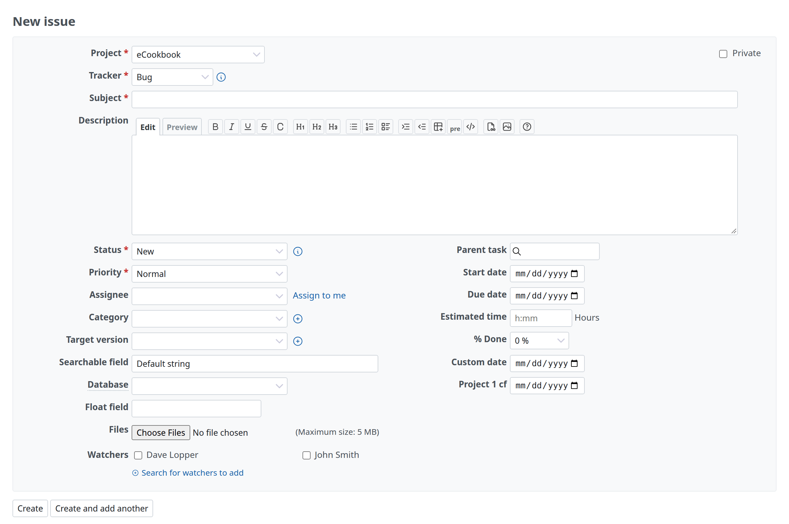
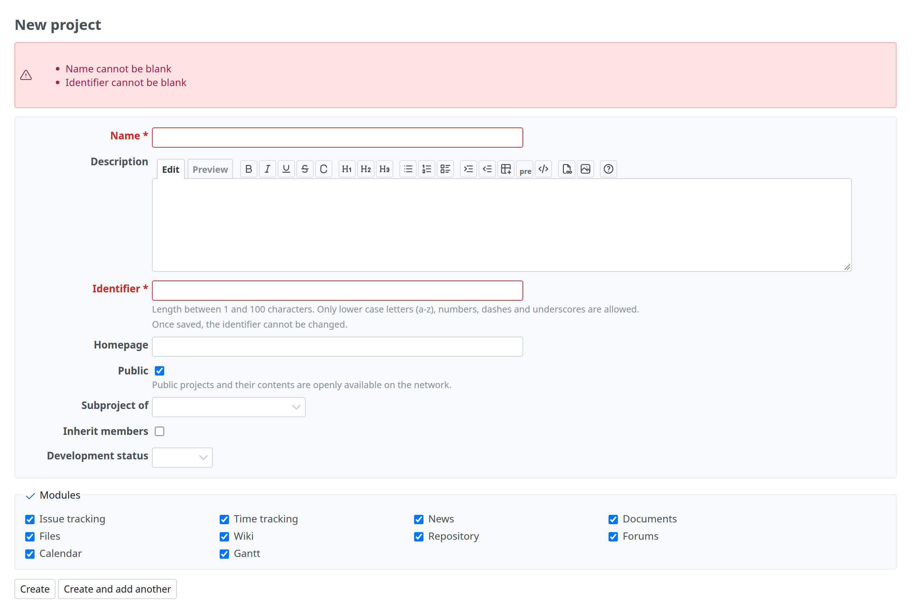

# Forms

A form to create or edit a record. The models are New project (`app/views/projects/new.html.erb`, `_form.html.erb`), New issue and the tracker form.



## Markup

`labelled_form_for` builds a form whose field helpers write the label too. The fields are in `div.box.tabular`, one `<p>` per field; the errors come first, the buttons after the box. From `app/views/projects/new.html.erb` and `app/views/projects/_form.html.erb`:

```erb
<%= title l(:label_project_new) %>

<%= labelled_form_for @project, :html => {:multipart => true} do |f| %>
<%= render :partial => 'form', :locals => { :f => f } %>
<%= submit_tag l(:button_create) %>
<%= submit_tag l(:button_create_and_continue), :name => 'continue' %>
<% end %>
```

```erb
<%= error_messages_for 'project' %>

<div class="box tabular">
<p><%= f.text_field :name, :required => true, :size => 60 %></p>

<p><%= f.textarea :description, :rows => 8, :class => 'wiki-edit', :data => wiki_textarea_stimulus_attributes %></p>
<p><%= f.text_field :identifier, :required => true, :size => 60, :maxlength => Project::IDENTIFIER_MAX_LENGTH %>
  <em class="info"><%= l(:text_length_between, :min => 1, :max => Project::IDENTIFIER_MAX_LENGTH) %></em></p>
<p><%= f.text_field :homepage, :size => 60 %></p>
</div>
```

| Item | Details |
| --- | --- |
| Labels | The builder uses the model's attribute name, or `:label` (a locale key or text). `.tabular p` has `padding-inline-start: 180px`; `.tabular label` is bold, end-aligned, 175px wide and floats into that column (`margin-inline-start: -180px`, `line-height: 24px`) |
| Required fields | `:required => true` adds `<span class="required"> *</span>` to the label (red, `--oc-red-9`) |
| A field with an error | Its label gets `class="error"` (red) |
| Help under a field | `em.info` in the same `<p>` |
| Fields side by side | `.tabular label.inline` (normal weight, not floating) or two columns with `.splitcontent` ([Page structure](page.md#two-columns)) |
| Field widths | `.tabular input` and `select` are at most 95% wide, `textarea` 95% wide and resizable in height |
| Buttons | `submit_tag` after the box: the main action first (`button_create`, `button_save`), then a secondary one (`button_create_and_continue`). A cancel link, where there is one, follows as a plain link (`link_to l(:button_cancel), …`, as in `app/views/enumerations/destroy.html.erb`) |

## Groups of fields

A group of fields with a title is a `fieldset.box` with a `legend` (`fieldset`: a 1px border; `legend`: the dark text color). The tracker form puts the projects in one, with a link that checks or unchecks all of them. From `app/views/trackers/_form.html.erb`:

```erb
<fieldset class="box" id="tracker_project_ids"><legend><%= toggle_checkboxes_link("#tracker_project_ids input[type=checkbox]") %><%= l(:label_project_plural) %></legend>
  …
</fieldset>
```

A group that can be folded is `fieldset.collapsible` ([Lists](lists.md#filters)).

## Errors

`error_messages_for` lists the errors of one or more records in `#errorExplanation`, at the top of the form:



```html
<div id="errorExplanation">
  <svg class="s18 icon-svg" …>…</svg>
  <ul>
    <li>Name cannot be blank</li>
    …
  </ul>
</div>
```

See [Messages](messages.md) for the other messages.
