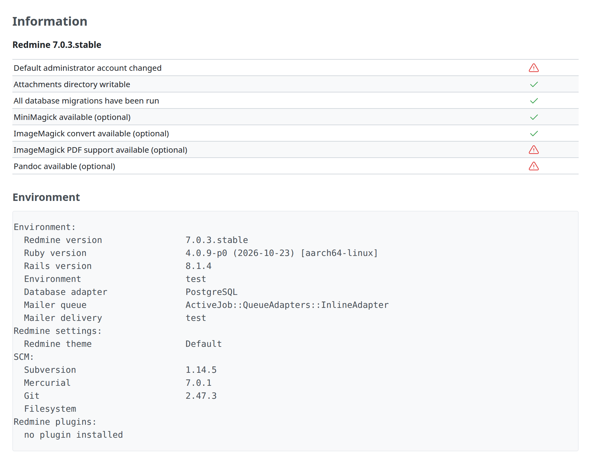

# Information

Values and checks to show, not to edit: the state of a connection, versions, what a feature found. The model is Administration › Information (`app/views/admin/info.html.erb`).



## Markup

```erb
<h2><%=l(:label_information_plural)%></h2>

<p><strong><%= Redmine::Info.versioned_name %></strong></p>

<table class="list">
<% @checklist.each do |label, result| %>
  <tr>
    <td class="name"><%= label.is_a?(Symbol) ? l(label) : label %></td>
    <td class="tick">
      <span class="icon-only icon-<%= result ? "ok" : "error" %>">
        <%= result ? sprite_icon('checked') : sprite_icon('warning') %>
      </span>
    </td>
  </tr>
<% end %>
</table>
<br />
<h3><%= l(:label_environment) %></h3>
<div class="box autoscroll">
<pre><%= Redmine::Info.environment %></pre>
</div>
```

- **Name and value:** a `table.list` without a header row; the name in `td.name` (start-aligned), the value in a plain `td` or, for a check, in `td.tick` with an icon. The table spans the width like every `table.list`; the name column takes what the names need.
- **Checks:** `span.icon-only.icon-ok` with the `checked` icon when it passes, `span.icon-only.icon-error` with the `warning` icon when it fails. The classes color the icons green and red.
- **Text output** (an environment, a log, a command's output): a `pre` in `div.box.autoscroll`, which scrolls sideways instead of widening the page (`.autoscroll`: `overflow-x: auto`, `margin-block-end: 1.2em`).
- **Space before the next section:** the `<br />` after the table ([Lists](lists.md#spacing-after-a-list)).

