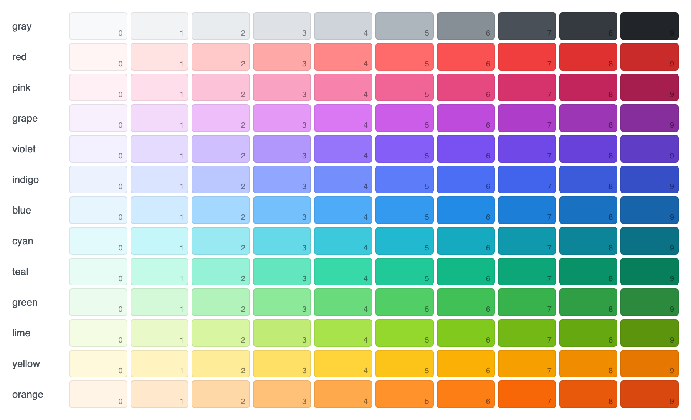

# カラーパレット

Redmine 7.0.3 の色は、[Open Color](https://yeun.github.io/open-color/) 1.9.1(MIT License)です。`app/assets/stylesheets/open-color.css` が、13 色を 10 段階ずつと白と黒を、`:root` の CSS 変数として定めています(13〜340 行目)。`app/assets/stylesheets/application.css` は、独自の変数を 3 つ足し(43〜46 行目)、ほとんどの色をこれらの変数で指定しています。このページの値と行番号は、この 2 つのファイルから読み取ったものです。

## 本体の変数を使う

プラグインの CSS では、`#ced4da` ではなく `var(--oc-gray-4)` と書きます。テーマは、`:root` でこれらの変数を定め直して Redmine の見た目を変えます([Redmine 7 のテーマ](themes.md))。変数を使ったプラグインはテーマに合わせて色が変わり、値を直接書いたプラグインは変わりません。

変数は色相ではなく役割で選び、その役割に本体が使っているものと同じにします(下の表)。透明度を付けるときは、open-color.css がそれぞれの色の隣に定めている `-rgb` の変数を使います。本体も `rgba(var(--oc-gray-9-rgb), 0.1)` と書いています(application.css の 292 行目)。成功、エラー、警告には、新しい色を使わず、本体のクラス(`div.flash.notice` など。[メッセージ](messages.md))を使います。

## 役割ごとの色

| 役割 | 変数 | application.css の行 |
| --- | --- | --- |
| 文字 |  `--oc-gray-9` | 49 |
| 見出し |  `--oc-gray-7` | 69 |
| リンク |  `--oc-blue-9` | 412 |
| マウスを乗せたリンク |  `--oc-red-9` | 413 |
| 控えめな文字(終了したチケット、ロックしたユーザー) |  `--oc-gray-6` | 416 |
| 薄い文字(フッター) |  `--oc-gray-5` | 379 |
| 枠線(入力欄、サイドバー、`h4`、一覧の見出し) |  `--oc-gray-4` | 848 |
| 箱(`.box`): 背景、枠線 |  `--oc-gray-0`  `--oc-gray-2` | 814 |
| サイドバーの背景 |  `--oc-gray-0` | 320 |
| 一覧の見出し(`table.list th`) |  `--oc-gray-2` | 560 |
| 一覧の偶数の行 |  `--oc-gray-0` | 726 |
| マウスを乗せた行 |  `--oc-yellow-0` | 728 |
| ヘッダー |  `--color-header-background` | 150 |
| トップメニュー |  `--color-top-menu-background` | 91 |
| プロジェクトのメニューの帯 |  `--oc-indigo-0` | 215 |
| 選択中の項目の目印 |  `--color-current-marker` | 263 |
| フォーカスした入力欄の枠線 |  `--oc-blue-5` | 881 |
| 成功(`div.flash.notice`): 背景、枠線、文字 |  `--oc-green-1`  `--oc-green-3`  `--oc-green-9` | 1548 |
| エラー(`div.flash.error`、`#errorExplanation`) |  `--oc-red-1`  `--oc-red-3`  `--oc-pink-9` | 1527 |
| 警告(`div.flash.warning`、`.conflict`) |  `--oc-yellow-1`  `--oc-yellow-3`  `--oc-pink-9` | 1557 |
| データなし、警告(`.nodata`、`.warning`) |  `--oc-yellow-1`  `--oc-yellow-3`  `--oc-pink-9` | 1567 |
| 進捗のバー: 完了、進行中、未着手 |  `--oc-green-7`  `--oc-green-4`  `--oc-gray-3` | 1800 |
| プライベートのバッジ |  `--oc-red-8`  `--oc-white` | 2158 |
| ユーザーへのメンション |  `--oc-blue-0` | 419 |

## Redmine 独自の変数

| 変数 | 値 | 行 | 使い道 |
| --- | --- | --- | --- |
|  `--color-current-marker` | `var(--oc-indigo-5)` | 43 | プロジェクトのメニューとサイドバーの選択中の項目の目印、カレンダーの今日 |
|  `--color-top-menu-background` | `#234761` | 45 | トップメニュー |
|  `--color-header-background` | `#3A78A3` | 46 | ヘッダー |

2 つの背景の色は Open Color にないので、本体は 16 進の値で書いています(44 行目の注記)。

## コントラスト

本体が使う文字と背景の組み合わせのコントラスト比です。WCAG 2.2 の式で計算しました。レベル AA には、通常の文字で 4.5:1、大きな文字(18pt、太字なら 14pt)で 3:1 が要ります。

| 組み合わせ | 文字 | 背景 | 比 | AA |
| --- | --- | --- | --- | --- |
| 白の上の文字 |  `--oc-gray-9` |  `#ffffff` | 15.43:1 | 合格 |
| 白の上の見出し |  `--oc-gray-7` |  `#ffffff` | 8.18:1 | 合格 |
| 白の上のリンク |  `--oc-blue-9` |  `#ffffff` | 6.09:1 | 合格 |
| 偶数の行とサイドバーの上のリンク |  `--oc-blue-9` |  `--oc-gray-0` | 5.77:1 | 合格 |
| マウスを乗せたリンク |  `--oc-red-9` |  `#ffffff` | 5.46:1 | 合格 |
| 白の上の控えめな文字 |  `--oc-gray-6` |  `#ffffff` | 3.32:1 | 大きな文字だけ合格 |
| 白の上のフッターの文字 |  `--oc-gray-5` |  `#ffffff` | 2.07:1 | 不合格 |
| エラー |  `--oc-pink-9` |  `--oc-red-1` | 5.95:1 | 合格 |
| 成功 |  `--oc-green-9` |  `--oc-green-1` | 3.81:1 | 大きな文字だけ合格 |
| 警告、データなし |  `--oc-pink-9` |  `--oc-yellow-1` | 6.46:1 | 合格 |
| 一覧の見出し |  `--oc-gray-9` |  `--oc-gray-2` | 13.01:1 | 合格 |
| ヘッダーの文字 |  `#ffffff` |  `--color-header-background` | 4.78:1 | 合格 |
| トップメニューの文字 |  `--oc-gray-2` |  `--color-top-menu-background` | 8.25:1 | 合格 |
| プロジェクトのメニューの文字 |  `--oc-gray-8` |  `--oc-indigo-0` | 10.27:1 | 合格 |
| プライベートのバッジ |  `#ffffff` |  `--oc-red-8` | 4.51:1 | 合格 |

控えめな文字(`--oc-gray-6`)、フッター(`--oc-gray-5`)、成功のメッセージ(`--oc-green-1` の上の `--oc-green-9`)は、本体でも 4.5:1 に届いていません。本体と同じく補助の情報にだけ使い、プラグインの主な文章にはこれらの色を使わないようにします。

## パレット

open-color.css のすべての色の変数です。`--oc-white` は `#ffffff`、`--oc-black` は `#000000` です。

| 色 | 0 | 1 | 2 | 3 | 4 | 5 | 6 | 7 | 8 | 9 |
| --- | --- | --- | --- | --- | --- | --- | --- | --- | --- | --- |
| `--oc-gray-*` |  `#f8f9fa` |  `#f1f3f5` |  `#e9ecef` |  `#dee2e6` |  `#ced4da` |  `#adb5bd` |  `#868e96` |  `#495057` |  `#343a40` |  `#212529` |
| `--oc-red-*` |  `#fff5f5` |  `#ffe3e3` |  `#ffc9c9` |  `#ffa8a8` |  `#ff8787` |  `#ff6b6b` |  `#fa5252` |  `#f03e3e` |  `#e03131` |  `#c92a2a` |
| `--oc-pink-*` |  `#fff0f6` |  `#ffdeeb` |  `#fcc2d7` |  `#faa2c1` |  `#f783ac` |  `#f06595` |  `#e64980` |  `#d6336c` |  `#c2255c` |  `#a61e4d` |
| `--oc-grape-*` |  `#f8f0fc` |  `#f3d9fa` |  `#eebefa` |  `#e599f7` |  `#da77f2` |  `#cc5de8` |  `#be4bdb` |  `#ae3ec9` |  `#9c36b5` |  `#862e9c` |
| `--oc-violet-*` |  `#f3f0ff` |  `#e5dbff` |  `#d0bfff` |  `#b197fc` |  `#9775fa` |  `#845ef7` |  `#7950f2` |  `#7048e8` |  `#6741d9` |  `#5f3dc4` |
| `--oc-indigo-*` |  `#edf2ff` |  `#dbe4ff` |  `#bac8ff` |  `#91a7ff` |  `#748ffc` |  `#5c7cfa` |  `#4c6ef5` |  `#4263eb` |  `#3b5bdb` |  `#364fc7` |
| `--oc-blue-*` |  `#e7f5ff` |  `#d0ebff` |  `#a5d8ff` |  `#74c0fc` |  `#4dabf7` |  `#339af0` |  `#228be6` |  `#1c7ed6` |  `#1971c2` |  `#1864ab` |
| `--oc-cyan-*` |  `#e3fafc` |  `#c5f6fa` |  `#99e9f2` |  `#66d9e8` |  `#3bc9db` |  `#22b8cf` |  `#15aabf` |  `#1098ad` |  `#0c8599` |  `#0b7285` |
| `--oc-teal-*` |  `#e6fcf5` |  `#c3fae8` |  `#96f2d7` |  `#63e6be` |  `#38d9a9` |  `#20c997` |  `#12b886` |  `#0ca678` |  `#099268` |  `#087f5b` |
| `--oc-green-*` |  `#ebfbee` |  `#d3f9d8` |  `#b2f2bb` |  `#8ce99a` |  `#69db7c` |  `#51cf66` |  `#40c057` |  `#37b24d` |  `#2f9e44` |  `#2b8a3e` |
| `--oc-lime-*` |  `#f4fce3` |  `#e9fac8` |  `#d8f5a2` |  `#c0eb75` |  `#a9e34b` |  `#94d82d` |  `#82c91e` |  `#74b816` |  `#66a80f` |  `#5c940d` |
| `--oc-yellow-*` |  `#fff9db` |  `#fff3bf` |  `#ffec99` |  `#ffe066` |  `#ffd43b` |  `#fcc419` |  `#fab005` |  `#f59f00` |  `#f08c00` |  `#e67700` |
| `--oc-orange-*` |  `#fff4e6` |  `#ffe8cc` |  `#ffd8a8` |  `#ffc078` |  `#ffa94d` |  `#ff922b` |  `#fd7e14` |  `#f76707` |  `#e8590c` |  `#d9480f` |

テーマで変えた色を見るときは、[Redmine Lookbook](https://redmine-kit.github.io/redmine_lookbook/ja/previews.html#basics) の「Color palette」のプレビューを開きます。ページから変数を読み取るので、テーマの値がそのまま出ます。
