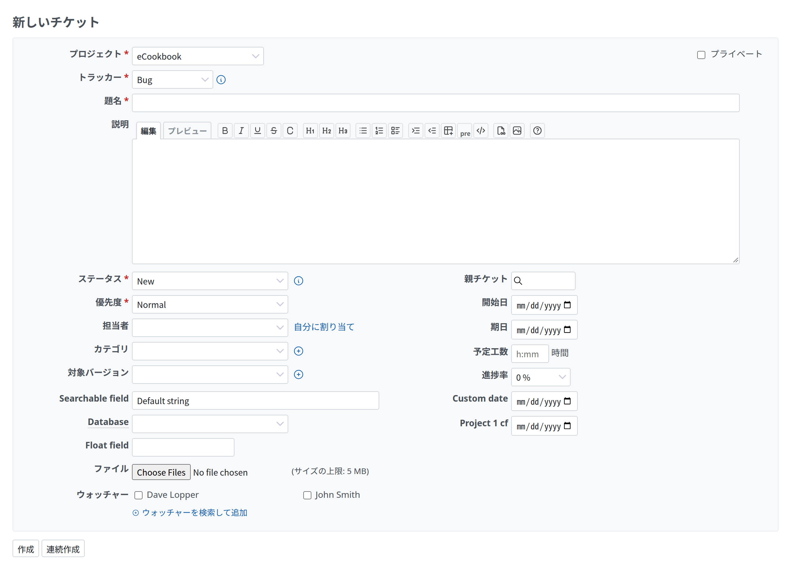
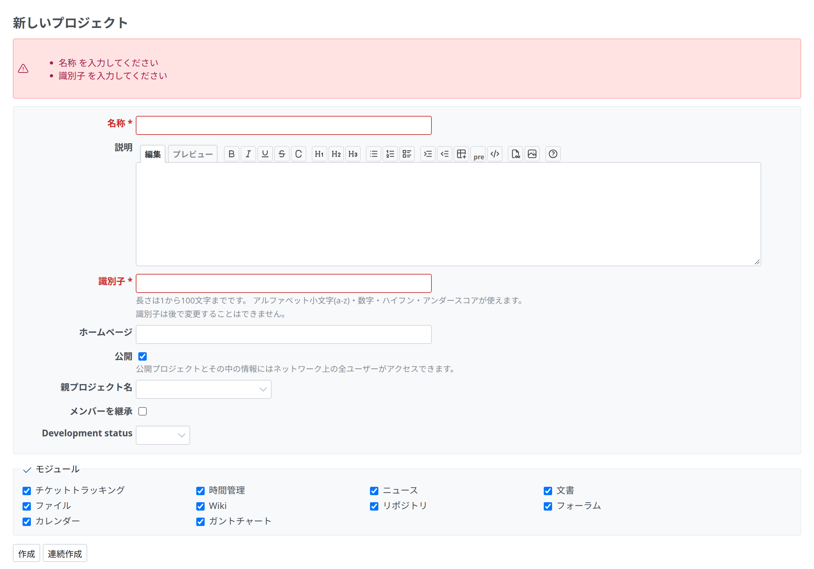

# フォーム

レコードを作る・編集するフォームです。手本は、新しいプロジェクト(`app/views/projects/new.html.erb`、`_form.html.erb`)、新しいチケット、トラッカーの編集です。



<a id="markup"></a>

## マークアップ

`labelled_form_for` は、項目のヘルパーがラベルも書くフォームを作ります。項目は `div.box.tabular` に、項目ごとに 1 つの `<p>` で書きます。エラーを最初に出し、ボタンはボックスのあとに置きます。`app/views/projects/new.html.erb` と `app/views/projects/_form.html.erb` から引用します。

```erb
<%= title l(:label_project_new) %>

<%= labelled_form_for @project, :html => {:multipart => true} do |f| %>
<%= render :partial => 'form', :locals => { :f => f } %>
<%= submit_tag l(:button_create) %>
<%= submit_tag l(:button_create_and_continue), :name => 'continue' %>
<% end %>
```

```erb
<%= error_messages_for 'project' %>

<div class="box tabular">
<p><%= f.text_field :name, :required => true, :size => 60 %></p>

<p><%= f.textarea :description, :rows => 8, :class => 'wiki-edit', :data => wiki_textarea_stimulus_attributes %></p>
<p><%= f.text_field :identifier, :required => true, :size => 60, :maxlength => Project::IDENTIFIER_MAX_LENGTH %>
  <em class="info"><%= l(:text_length_between, :min => 1, :max => Project::IDENTIFIER_MAX_LENGTH) %></em></p>
<p><%= f.text_field :homepage, :size => 60 %></p>
</div>
```

- **ラベル:** ビルダーは、モデルの属性の名前か、`:label`(ロケールのキーか文字)を使います。`.tabular p` は `padding-inline-start: 180px` で、`.tabular label` は太字、終わりの側に寄せ、幅 175px で、その列に回り込みます(`margin-inline-start: -180px`、`line-height: 24px`)。
- **必須の項目:** `:required => true` で、ラベルに `<span class="required"> *</span>` が付きます(赤、`--oc-red-9`)。
- **エラーのある項目:** ラベルに `class="error"` が付きます(赤)。
- **項目の下の説明:** 同じ `<p>` の中に `em.info` を置きます。
- **項目を横に並べる:** `.tabular label.inline`(ふつうの太さで、回り込まない)か、`.splitcontent` の 2 列にします([画面の組み立て](page.md#two-columns))。
- **項目の幅:** `.tabular input` と `select` は最大で 95% の幅、`textarea` は 95% の幅で、高さだけ変えられます。
- **ボタン:** ボックスのあとに `submit_tag` を置きます。主なアクション(`button_create`、`button_save`)を先に、次に補助のアクション(`button_create_and_continue`)です。キャンセルがあるときは、そのあとにふつうのリンクで置きます(`link_to l(:button_cancel), …`。`app/views/enumerations/destroy.html.erb` と同じ)。

<a id="groups-of-fields"></a>

## 項目のまとまり

タイトルのある項目のまとまりは、`legend` 付きの `fieldset.box` です(`fieldset`: 1px の枠。`legend`: 濃い文字の色)。トラッカーの編集は、プロジェクトをこれに入れ、すべてにチェックを付けたり外したりするリンクを置きます。`app/views/trackers/_form.html.erb` から引用します。

```erb
<fieldset class="box" id="tracker_project_ids"><legend><%= toggle_checkboxes_link("#tracker_project_ids input[type=checkbox]") %><%= l(:label_project_plural) %></legend>
  …
</fieldset>
```

折りたためるまとまりは `fieldset.collapsible` です([一覧](lists.md#filters))。

<a id="errors"></a>

## エラー

`error_messages_for` は、1 つ以上のレコードのエラーを、フォームの先頭の `#errorExplanation` に並べます。



```html
<div id="errorExplanation">
  <svg class="s18 icon-svg" …>…</svg>
  <ul>
    <li>名称を入力してください</li>
    …
  </ul>
</div>
```

ほかのメッセージは[メッセージ](messages.md)を参照してください。
