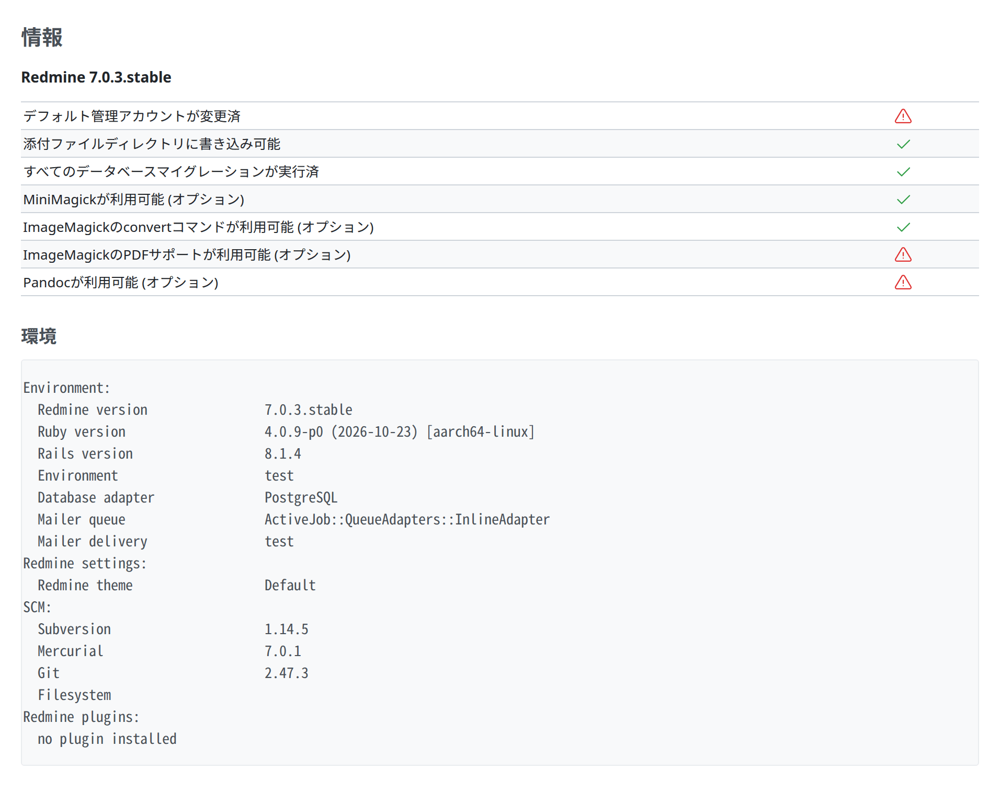

# 情報の表示

編集ではなく見せるための値と、確認の結果です。接続の状態、バージョン、機能が見つけたものなどです。手本は 管理 › 情報(`app/views/admin/info.html.erb`)です。



<a id="markup"></a>

## マークアップ

```erb
<h2><%=l(:label_information_plural)%></h2>

<p><strong><%= Redmine::Info.versioned_name %></strong></p>

<table class="list">
<% @checklist.each do |label, result| %>
  <tr>
    <td class="name"><%= label.is_a?(Symbol) ? l(label) : label %></td>
    <td class="tick">
      <span class="icon-only icon-<%= result ? "ok" : "error" %>">
        <%= result ? sprite_icon('checked') : sprite_icon('warning') %>
      </span>
    </td>
  </tr>
<% end %>
</table>
<br />
<h3><%= l(:label_environment) %></h3>
<div class="box autoscroll">
<pre><%= Redmine::Info.environment %></pre>
</div>
```

| 項目 | 内容 |
| --- | --- |
| 名前と値 | 見出しの行のない `table.list` にします。名前は `td.name`(始まりの側に寄せる)、値はふつうの `td`、確認の結果はアイコン付きで `td.tick` に入れます。表はほかの `table.list` と同じく全幅で、名前の列は名前に必要な幅を取ります |
| 値の元 | Redmine 本体の「情報」には、この場合がありません。値の元 (環境変数、設定のキー) を示すプラグインは、設定の画面がフィールドの下に説明を置くのと同じく、同じセルの値のあとに `em.info` を置きます (`em.info` は `display: block`、90 %、灰色)。Redmine AWS のプラグインは、これを redmine_aws の部分テンプレート `aws_admin/values` で共有します |
| 確認の結果 | 通ったときは `checked` のアイコンの `span.icon-only.icon-ok`、失敗したときは `warning` のアイコンの `span.icon-only.icon-error` です。クラスがアイコンを緑と赤にします |
- **文字の出力**(環境、ログ、コマンドの出力): `div.box.autoscroll` の中の `pre` にします。画面を広げずに横にスクロールします(`.autoscroll`: `overflow-x: auto`、`margin-block-end: 1.2em`)。
- **次のセクションまでの間隔:** 表のあとの `<br />` です([一覧](lists.md#spacing-after-a-list))。
