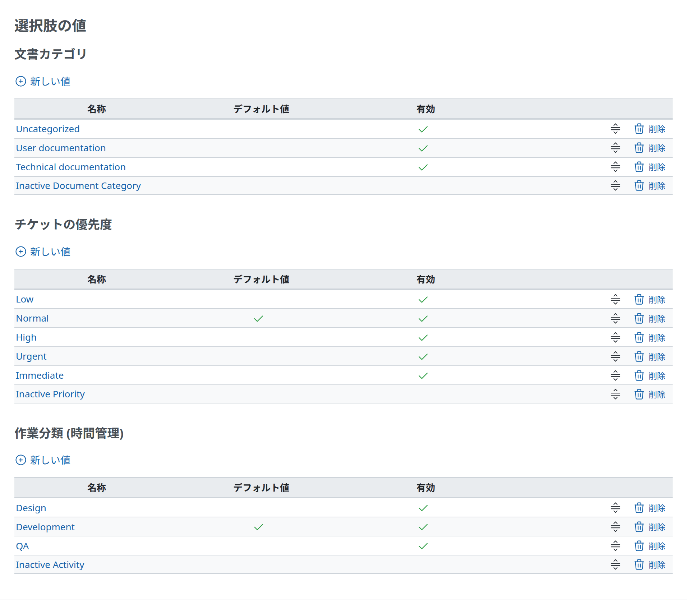

# 一覧

レコードの一覧に、レコードを足すアクションと、行ごとのアクションを付けたものです。手本は 管理 › 選択肢の値(`app/views/enumerations/index.html.erb`)です。



<a id="markup"></a>

## マークアップ

```erb
<h3><%= l(klass::OptionName) %></h3>

<p><%= link_to sprite_icon('add', l(:label_enumeration_new)), new_enumeration_path(:type => klass.name), :class => 'icon icon-add' %></p>

<% if enumerations.any? %>
<table class="list enumerations"><thead>
<tr>
    <th><%= l(:field_name) %></th>
    <th><%= l(:field_is_default) %></th>
    <th><%= l(:field_active) %></th>
    <th></th>
</tr></thead>
<% enumerations.each do |enumeration| %>
<tr>
    <td class="name"><%= link_to enumeration, edit_enumeration_path(enumeration) %></td>
    <td class="tick"><%= checked_image enumeration.is_default? %></td>
    <td class="tick"><%= checked_image enumeration.active? %></td>
    <td class="buttons">
      <%= reorder_handle(enumeration, :url => enumeration_path(enumeration), :param => 'enumeration') %>
      <%= delete_link enumeration_path(enumeration) %>
    </td>
</tr>
<% end %>
</table>
<% else %>
<p class="nodata"><%= l(:label_no_data) %></p>
<% end %>
```

- **足すアクション:** 画面に一覧が複数あるときは、見出しの下の `<p>` にアクションのリンクを置きます。一覧が 1 つの画面では、右上の `.contextual` に置きます([画面の組み立て](page.md#title-and-actions))。
- **一覧の種類のクラス:** `list` の隣に付けます(`enumerations`、`custom_fields`、`users`)。スクリプトとテーマが表を見分けるための名前で、本体がスタイルを当てているものもあります。
- **空のとき:** 空の表の代わりに、`label_no_data` の `p.nodata` を出します([メッセージ](messages.md#empty-states))。

<a id="columns"></a>

## 列

`table.list` は、すべてのセルを中央に寄せます。列のクラスで、それを変えます。

| クラス | 使い方 | 標準のスタイル |
| --- | --- | --- |
| `name` | レコードの名前。ふつうはリンク | 始まりの側に寄せる。`description`、`subject`、`comments`、`roles`、`text` も同じ |
| `tick` | はい・いいえの値。`checked_image` で出す | `inline-size: 15%`、中央 |
| `id` | レコードを見分ける番号 | `inline-size: 2%`、中央 |
| `buttons` | 行のアクション(`delete_link`、`reorder_handle`、ほかのアクションのリンク) | 終わりの側に寄せる。`white-space: nowrap`、リンクのあいだは `0.6em` |
| `reorder` | 並べ替えのハンドルの列 | `inline-size: 15%`、中央 |
| `checkbox` | 行を選ぶチェックボックス | `inline-size: 15px` |
| そのほか | 日付、件数、種類、状態 | 中央(標準のまま) |

- `table.list`: `inline-size: 100%`、`font-size: 0.8125rem`、上下に枠、`margin-block-end: 4px` です。
- `th`: 灰色の背景(`--oc-gray-2`)、`padding: 4px`、`white-space: nowrap`、下に 2px の枠です。
- `td`: `padding-block: 3px`、`padding-inline-end: 10px`、行ごとに上の枠があります。偶数の行は明るい背景になり(`tr:nth-child(even)`。`.box` の中では白)、マウスを乗せた行は色が変わります。
- `checked_image` は、真のときにチェックのアイコンを出し、偽のときは何も出しません。
- ボタンの列の `th` は、本体と同じく空にします。

<a id="spacing-after-a-list"></a>

## 一覧のあとの間隔

`table.list` の下の余白は `margin-block-end: 4px` だけです。次が見出しのとき、本体は次のどれかで間隔を取ります。

- **ページ送り:** `<span class="pagination"><%= pagination_links_full @user_pages, @user_count %></span>`(`app/views/users/index.html.erb`)で、一覧の下にページと 1 ページの件数を出します。
- **改行:** 管理 › 情報は、一覧のあと、次の `h3` の前に `<br />` を置きます。
- **次の一覧のアクションのリンク:** 選択肢の値では、次のセクションのアクションのリンクの `<p>` と、見出し自身の余白が、一覧のあいだを空けます。

<a id="filters"></a>

## フィルター

クエリーで作る一覧(チケット、ユーザー、プロジェクト、作業時間)は、`fieldset.collapsible` のフィルターから始まります(`app/views/queries/_query_form.html.erb`)。凡例(legend)で開閉し、保存したクエリーは閉じた状態で始まります。

```erb
<fieldset id="filters" class="collapsible <%= @query.new_record? ? "" : "collapsed" %>">
  <legend onclick="toggleFieldset(this);" class="icon icon-<%= @query.new_record? ? "expanded" : "collapsed" %>">
    <%= sprite_icon(@query.new_record? ? "angle-down" : "angle-right", rtl: !@query.new_record?) %>
    <%= l(:label_filter_plural) %>
  </legend>
  <div style="<%= @query.new_record? ? "" : "display: none;" %>">
    …
  </div>
</fieldset>
```

`fieldset.collapsible` は上の枠だけで(`border-width: 1px 0 0 0`)、凡例はマウスを乗せるとポインターになります。
