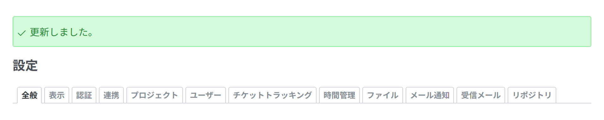
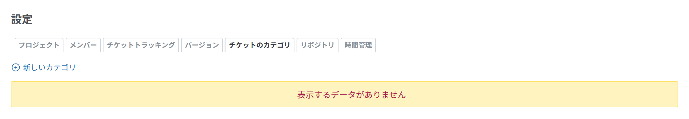

# メッセージ

アクションのあとの通知、エラー、警告、競合、データがないときの表示です。Redmine は、どれも 1 つのスタイルで描きます(`application.css` の `#errorExplanation, div.flash, .nodata, .warning, .conflict`)。`padding-block: 12px`、`padding-inline: 30px 4px`、`margin-block-end: 12px`、`font-size: 1.1em`、1px の枠、`border-radius: 3px` で、始まりの側にアイコンが付きます。



<a id="after-an-action"></a>

## アクションのあと

コントローラーが flash を入れてリダイレクトし、レイアウトが本文の先頭に出します(`render_flash_messages`)。

```ruby
flash[:notice] = l(:notice_successful_update)
redirect_to settings_path(:tab => params[:tab])
```

```html
<div class="flash notice" id="flash_notice"><svg class="s18 icon-svg" …>…</svg>更新しました。</div>
```

| flash のキー | 使い方 | 色 |
| --- | --- | --- |
| `notice` | アクションが成功した(`notice_successful_create`、`notice_successful_update`、`notice_successful_delete` など) | 緑 |
| `error` | アクションが失敗した | 赤 |
| `warning` | アクションは成功したが、知っておくことがある | 黄 |

- `div.flash` には、`margin-block-start: 8px` もあります。
- 合う場面では本体のメッセージ(`notice_successful_*`)を使います。どの言語でも、言い回しが本体とそろいます。

<a id="errors-in-a-form"></a>

## フォームのエラー

`error_messages_for 'record'` は、レコードのエラーを、フォームの先頭の `#errorExplanation`(赤)に出します([フォーム](forms.md#errors))。設定では `render_settings_error` を使います([設定](settings.md#errors-and-the-saved-notice))。

<a id="errors-from-a-service"></a>

## ほかのサービスからのエラー

ほかのサービスを呼んだ結果(API、接続の確認)を出す画面では、失敗を例外の文のまま出さず、このスタイルのメッセージにします。利用者の言語の短い文と、役に立つときはエラーのコードかクラスを出します。たとえば、プラグインのメッセージで、その場に警告を出します。

```erb
<p class="warning"><%= l(:text_my_plugin_connection_failed) %> (<%= error.code %>)</p>
```

詳しい内容は、画面には出さず、管理者のためにログに残します。

<a id="warnings-and-conflicts"></a>

## 警告と競合

- `.warning`: 黄色で中央に寄せます(`.nodata` と同じ)。たとえば、そのままでは使えない画面です。
- `.conflict`: 黄色で、編集しているあいだにほかの人が変えたレコードに使います(`app/views/issues/_conflict.html.erb`)。

<a id="empty-states"></a>

## データがないとき

一覧に出すものがないときは、表の代わりに `label_no_data` の `p.nodata` を出します。足すアクションは、その上に残します。`app/views/projects/settings/_issue_categories.html.erb` から引用します。

```erb
<p><%= link_to sprite_icon('add', l(:label_issue_category_new)), new_project_issue_category_path(@project), :class => 'icon icon-add' if User.current.allowed_to?(:manage_categories, @project) %></p>

<% if @project.issue_categories.any? %>
<table class="list">
  …
</table>
<% else %>
<p class="nodata"><%= l(:label_no_data) %></p>
<% end %>
```



`.nodata` は、`.warning` と同じく、中央に寄せた黄色です(背景 `--oc-yellow-1`、枠 `--oc-yellow-3`)。
