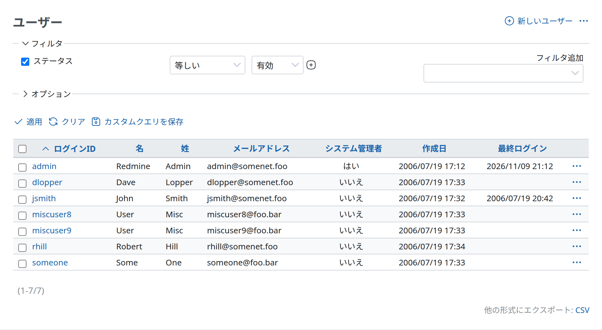
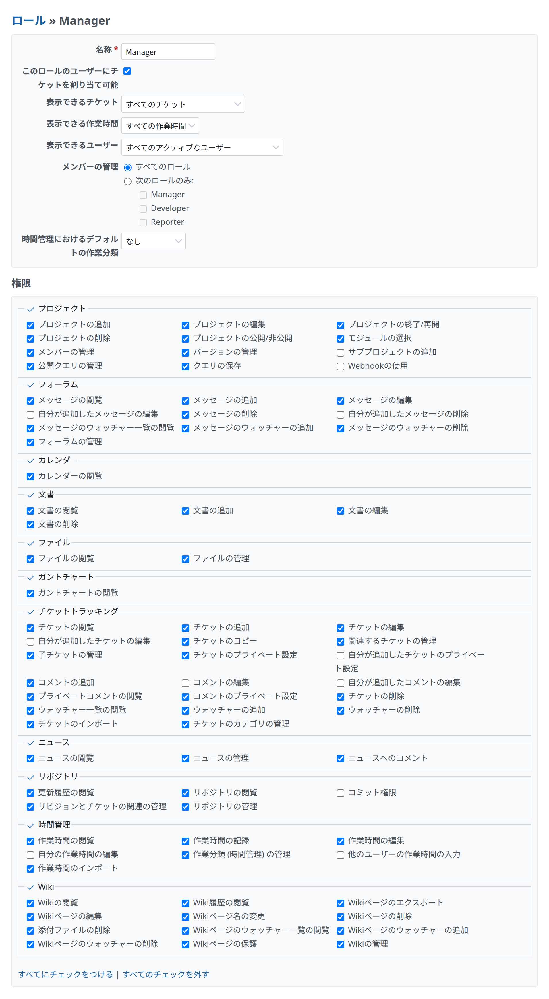
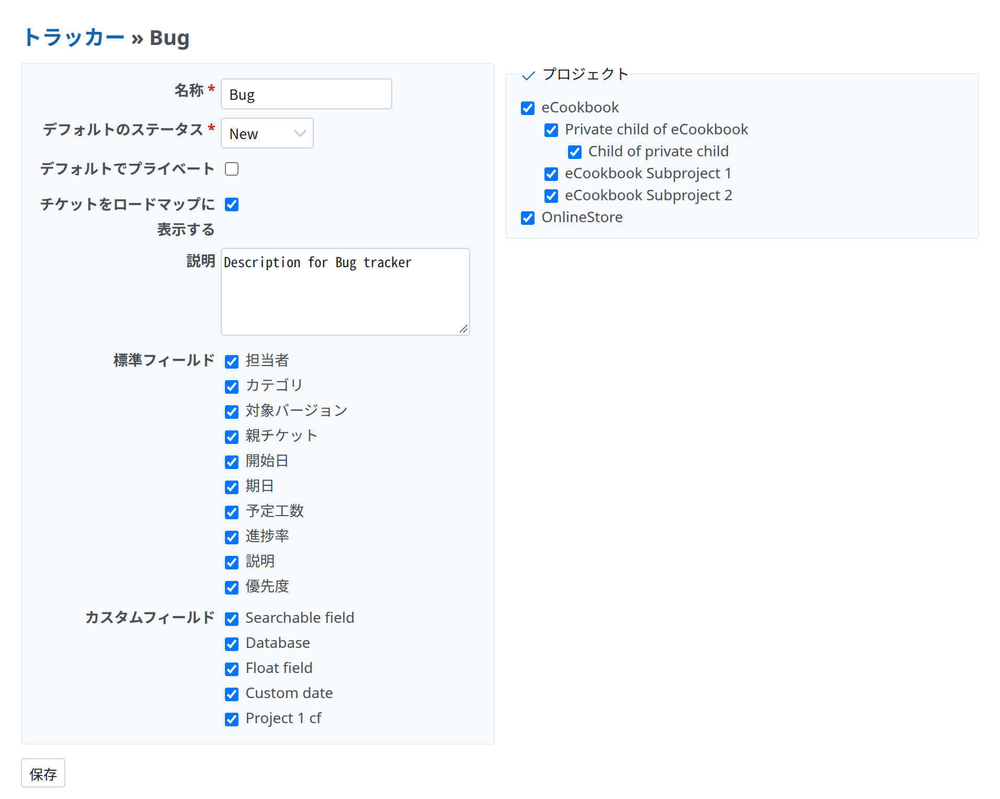
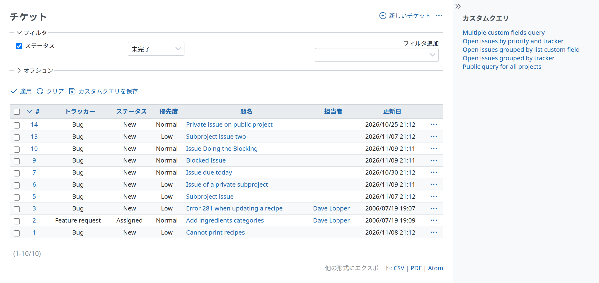

# 画面の組み立て

どの画面にもある部分です。タイトル、右上のアクション、セクション、サイドバー、2 列の配置を扱います。



<a id="title-and-actions"></a>

## タイトルとアクション

画面のアクションを `div.contextual` に入れて先に書き、そのあとに `h2` のタイトルを書きます。`title` は `h2` を書き(複数の部分を渡すとパンくずにします)、`html_title` はブラウザーのタイトルを決めます。`app/views/auth_sources/index.html.erb` から引用します。

```erb
<div class="contextual">
<%= link_to sprite_icon('add', l(:label_auth_source_new)), { :action => 'new'}, :class => 'icon icon-add' %>
</div>

<%= title l(:label_auth_source_plural) %>
```

- `.contextual` は行の終わりの側に回り込みます(`float: inline-end`)。`margin-block: 5px`、`padding-inline-start: 10px`、`font-size: 0.9em` です。マークアップでは `h2` より前に置くので、タイトルがその横に並びます。
- `h2` は `1.25rem`、`h3` は `1.0625rem` です。どの見出しも `margin-block: 0 10px`(上の余白はなし)と `padding-block: 2px 1px` です。
- アクションが複数あるときは、同じ `.contextual` に、それぞれアクションのリンクとして並べます([アイコンとリンク](icons-and-links.md))。めったに使わないアクションは、チケットの画面のように `…` のメニュー(`actions_dropdown`)に入れます。

<a id="sections"></a>

## セクション

セクションは、`h3` と、その下の `.box` です。セクションのあいだの間隔は、見出しではなく `.box` が作ります。`.box` は `margin-block-end: 12px` で、`h3` には上の余白がありません。`app/views/roles/_form.html.erb` から引用します。

```erb
<div class="box tabular">
  <p><%= f.text_field :name, :required => true %></p>
  …
</div>

<h3><%= l(:label_permissions) %></h3>
<div class="box tabular" id="permissions">
  …
</div>
```



- `.box`: `padding: 10px`、`margin-block-end: 12px`、明るい背景(`--oc-gray-0`)、1px の枠(`--oc-gray-2`)、`border-radius: 3px`、`line-height: 1.5em` です。
- ボックスに入れずに表で終わるセクションでは(`table.list` の下の余白は `margin-block-end: 4px` だけ)、次の `h3` までの間隔がほとんどありません。本体は、表のあとに `<br />` を置くか(管理 › 情報)、自分の余白を持つ次のかたまり(ページ送り、`.box`)を続けます。[一覧](lists.md#spacing-after-a-list)を参照してください。

<a id="two-columns"></a>

## 2 列の配置

`.splitcontent` に `.splitcontentleft` と `.splitcontentright` を入れると、2 つのかたまりが横に並びます。狭い画面では縦に折り返します。`app/views/trackers/_form.html.erb` から引用します。

```erb
<div class="splitcontent">
<div class="splitcontentleft">
<div class="box tabular">
  …
</div>
</div>

<div class="splitcontentright">
<fieldset class="box" id="tracker_project_ids"><legend><%= toggle_checkboxes_link("#tracker_project_ids input[type=checkbox]") %><%= l(:label_project_plural) %></legend>
  …
</fieldset>
</div>
</div>
```



- `.splitcontent` は折り返すフレックスボックスです。どちらの列も `flex: 1` で、あいだは `5px` です。

<a id="sidebar"></a>

## サイドバー

画面は `content_for :sidebar` でサイドバーの中身を入れます。サイドバーは、セクションに `h3` を使い、リンクは飾りのない一覧にします。



- `#sidebar`: `font-size: 0.8125rem`、`padding-inline: 20px 8px`、明るい背景、始まりの側に枠があります。
- `#sidebar h3`: `0.875rem`、`margin-block-start: 14px`(最初の見出しはなし)です。
- `#sidebar ul` には余白も字下げもありません。今の項目は `a.selected` です。

サイドバーは、画面が中身を入れたときだけ表示され、利用者が隠せます(`#sidebar-switch-button`)。
