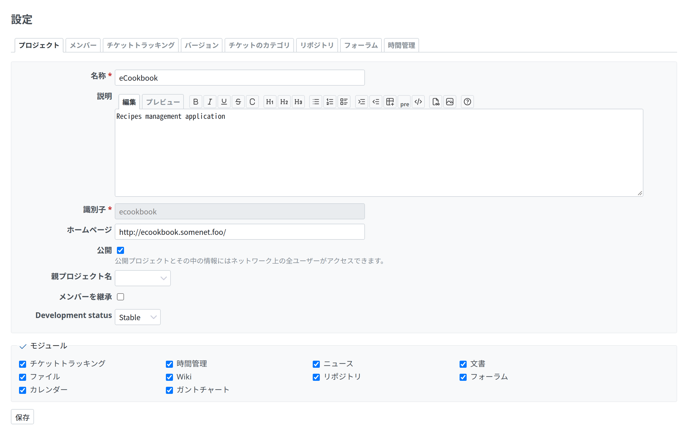

# プロジェクトの設定

プロジェクトの設定は、プロジェクト › 設定(`app/views/projects/settings.html.erb`)のタブで、どのタブも `app/views/projects/settings/` の下の部分テンプレートです。



<a id="the-tabs"></a>

## タブ

```erb
<h2><%=l(:label_settings)%></h2>

<%= render_tabs project_settings_tabs %>
```

`project_settings_tabs`(`app/helpers/projects_helper.rb`)は、タブを並べ、利用者が使えるものだけを残します。

```ruby
{:name => 'issues', :action => :edit_project, :module => :issue_tracking,
 :partial => 'projects/settings/issues', :label => :label_issue_tracking},
…
tabs.
  select {|tab| User.current.allowed_to?(tab[:action], @project)}.
  select {|tab| tab[:module].nil? || @project.module_enabled?(tab[:module])}
```

- `:action` はタブを出す権限、`:module` はタブに要るプロジェクトのモジュールです。
- Redmine には、プロジェクトの設定のタブを足すフックがありません。プラグインは、`super` を呼んで自分のタブを足すモジュールを `ProjectsHelper` に prepend して、自分の権限付きのタブを足します。

```ruby
module MyPlugin
  module ProjectSettingsTab
    def project_settings_tabs
      tabs = super
      if User.current.allowed_to?(:manage_my_plugin, @project)
        tabs << {name: 'my_plugin', action: :manage_my_plugin,
                 partial: 'my_plugin/project_settings', label: :label_my_plugin}
      end
      tabs
    end
  end
end

ProjectsHelper.prepend(MyPlugin::ProjectSettingsTab)
```

<a id="a-tabs-content"></a>

## タブの中身

タブは、ほかと同じフォームです([フォーム](forms.md))。プロジェクト(かプラグインのレコード)の `labelled_form_for`、保存のあと同じタブに戻るための隠し項目 `tab`、`.box.tabular` の項目、保存のボタンでできています。`app/views/projects/settings/_issues.html.erb` から引用します。

```erb
<%= labelled_form_for @project, html: {id: 'project_issue_tracking' } do |f| %>
  <%= hidden_field_tag 'tab', 'issues' %>

  <fieldset class="box tabular" id="project_trackers"><legend><%= toggle_checkboxes_link('#project_trackers input[type=checkbox]') %><%= l(:label_tracker_plural)%></legend>
  <% if User.current.admin? %>
    <div class="contextual"><%= link_to sprite_icon('settings', l(:label_administration)), trackers_path, :class => "icon icon-settings" %></div>
  <% end %>
  <% @trackers.each do |tracker| %>
    <label class="floating">
      <%= check_box_tag 'project[tracker_ids][]', tracker.id, @project.trackers.to_a.include?(tracker), :id => nil %>
      <%= tracker_name_tag tracker %>
    </label>
  <% end %>
  </fieldset>
  …
<% end %>
```

- **ボックスにたくさんのチェックボックス:** `label.floating`(ふつうの太さ、始まりの側に寄せ、幅 270px)で、列に並べます。
- **管理者のための、対応する管理画面へのリンク:** fieldset の中の `.contextual` に、`icon icon-settings` で置きます。
- **アクションのある一覧**(バージョン、カテゴリー、リポジトリ)は[一覧](lists.md)に倣い、足すアクションを一覧の上の `<p>` のリンクにします。
