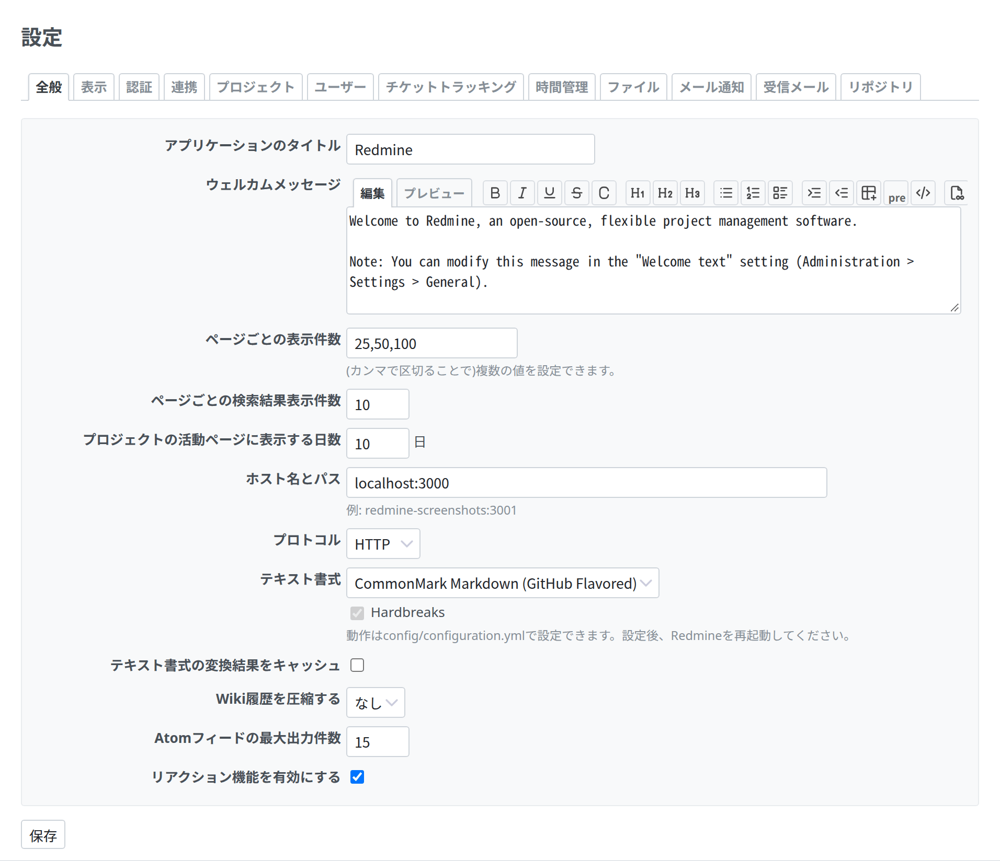
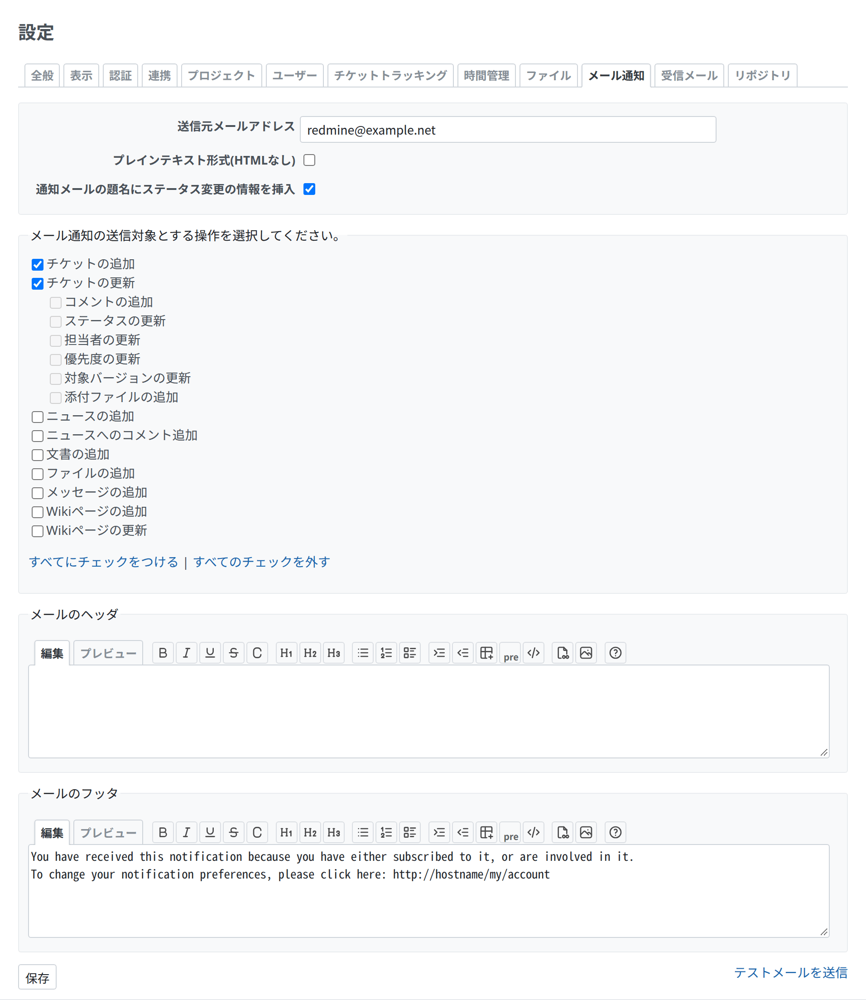

# 設定

タブに分かれた設定で、どのタブもラベル付きの項目のフォームです。手本は 管理 › 設定(`app/views/settings/edit.html.erb` と、部分テンプレートの `app/views/settings/_*.html.erb`)です。



<a id="tabs"></a>

## タブ

`render_tabs` は、ハッシュの並びから、タブとタブごとの中身を描きます。選ばれるタブは `tab` のパラメーターで決まります。`app/views/settings/edit.html.erb` から引用します。

```erb
<h2><%= l(:label_settings) %></h2>

<%= render_settings_error @setting_errors %>

<%= render_tabs administration_settings_tabs %>
```

```ruby
tabs = [
  {:name => 'general', :partial => 'settings/general', :label => :label_general},
  {:name => 'display', :partial => 'settings/display', :label => :label_display},
  …
]
```

- `#content .tabs`: `block-size: 2.6em`、`margin-block-end: 1.2em` です。選んだタブは `a.selected` です。タブが入りきらないときは、スクロールのボタン(`div.tabs-buttons`)が出ます。
- タブの中身は、それぞれ `tab-content-<name>` の ID の `div.tab-content` です。ほかのタブの中身は隠れます。

<a id="fields"></a>

## 項目

1 つのタブが 1 つのフォームです。項目は `div.box.tabular.settings` に、設定ごとに 1 つの `<p>` で、`setting_*` のヘルパーを使って書きます。保存のボタンはボックスのあとです。`app/views/settings/_general.html.erb` から引用します。

```erb
<%= form_tag({:action => 'edit'}) do %>

<div class="box tabular settings">
<p><%= setting_text_field :app_title, :size => 30 %></p>

<p><%= setting_text_field :per_page_options, :size => 20 %>
<em class="info"><%= l(:text_comma_separated) %></em></p>

<p><%= setting_text_field :activity_days_default, :size => 6 %> <%= l(:label_day_plural) %></p>

<p><%= setting_select :protocol, [['HTTP', 'http'], ['HTTPS', 'https']] %></p>
</div>

<%= submit_tag l(:button_save) %>
<% end %>
```

- `setting_text_field`、`setting_textarea`、`setting_select`、`setting_multiselect`、`setting_check_box` は、ラベル(ロケールの `setting_<name>`、または `:label`)と項目を書きます。`setting_check_box` は、チェックを外した値も保存されるよう、隠し項目の `0` も書きます。
| 項目 | 内容 |
| --- | --- |
| ラベル | `.tabular label` は太字で、終わりの側に寄せ、左の列に回り込みます。`.tabular.settings` の左の列は 300px で(`p` は `padding-inline-start: 300px`、`font-size: 93%`。`label` は幅 295px、`margin-inline-start: -300px`)、ほかのフォーム(180px)より広くなっています。ラベルは 1 行に収まる長さにし、長い説明は `em.info` に書きます |
| 項目の下の説明 | 項目のあと、同じ `<p>` の中に `em.info` を置きます(`display: block`、`font-size: 90%`、灰色) |
| 項目のあとの単位 | 項目のあとに文字をそのまま書きます(`… %> <%= l(:label_day_plural) %>`) |
| ボックスを分ける | 長いタブは、ボックスを分けてまとまりにします。ボックスのあいだの間隔は、`.box` の `margin-block-end: 12px` が作ります |

<a id="checkboxes-with-their-text-after-them"></a>

## 後ろに文字のあるチェックボックス

項目の付属の選択肢で、チェックボックスの後ろに文字を置くものです。項目の `<p>` の中で、チェックボックスを `label.block` で包み、左のラベルを書かないよう `:label => false` にします。`app/views/settings/_mail_handler.html.erb` から引用します。

```erb
<p>
  <%= setting_textarea :mail_handler_body_delimiters, :rows => 5 %>
  <label class="block">
    <%= setting_check_box :mail_handler_enable_regex_delimiters, :label => false %>
    <%= l(:setting_mail_handler_enable_regex) %>
  </label>
  <em class="info"><%= l(:text_line_separated) %></em>
</p>
```

- `.tabular label.block`: ふつうの太さで、始まりの側に寄せ、回り込まず、全幅(`display: block`)です。

関連する選択肢のまとまりで、どれもチェックボックスの後ろに文字を置くものは、`legend` 付きの `fieldset.box` に、選択肢ごとの `label` と、すべてにチェック・すべて外すのリンクを入れます。`app/views/settings/_notifications.html.erb` から引用します。

```erb
<fieldset class="box" id="notified_events"><legend><%=l(:text_select_mail_notifications)%></legend>
<%= hidden_field_tag 'settings[notified_events][]', '' %>
<% @notifiables.each do |notifiable| %>
<%= notification_field notifiable %>
<br />
<% end %>
<p><%= check_all_links('notified_events') %></p>
</fieldset>
```



- `notification_field` は `<label><input type="checkbox" …> 文字</label>` を書きます。子の選択肢には `class="parent"` が付き、字下げされます(`fieldset#notified_events .parent`: `padding-inline-start: 20px`)。
- `check_all_links` は「すべてにチェックをつける | すべてのチェックを外す」を書きます。

<a id="a-related-action"></a>

## 関連するアクション

テストメールの送信のように、設定のそばに置くアクションは、終わりの側に寄せたふつうのリンクにして、保存のボタンと同じ行に置きます。同じ部分テンプレートから引用します。

```erb
<div style="float:right;">
<%= link_to l(:label_send_test_email), test_email_path, :method => :post %>
</div>

<%= submit_tag l(:button_save) %>
```

<a id="errors-and-the-saved-notice"></a>

## エラーと保存の通知

- `render_settings_error @setting_errors` は、保存できなかった設定を、そのラベルと一緒に、タブの上の `#errorExplanation` に並べます。
- 保存のあと、コントローラーは `flash[:notice] = l(:notice_successful_update)` にして、同じタブにリダイレクトします。レイアウトが、タイトルの上にそれを出します([メッセージ](messages.md))。

<a id="a-plugins-settings"></a>

## プラグインの設定

`settings :partial => 'settings/…'` を宣言したプラグインには、管理 › プラグイン › 設定 ができます。Redmine はその部分テンプレートを同じ `.box.tabular.settings` で包むので(`app/views/settings/plugin.html.erb`)、部分テンプレートには `<p>` の行だけを書きます。

```erb
<div id="settings" class="plugin plugin-<%= @plugin.id %>">
<%= form_tag({:action => 'plugin'}) do %>
<div class="box tabular settings">
<%= render :partial => @partial, :locals => {:settings => @settings}%>
</div>
<%= submit_tag l(:button_apply) %>
<% end %>
</div>
```
