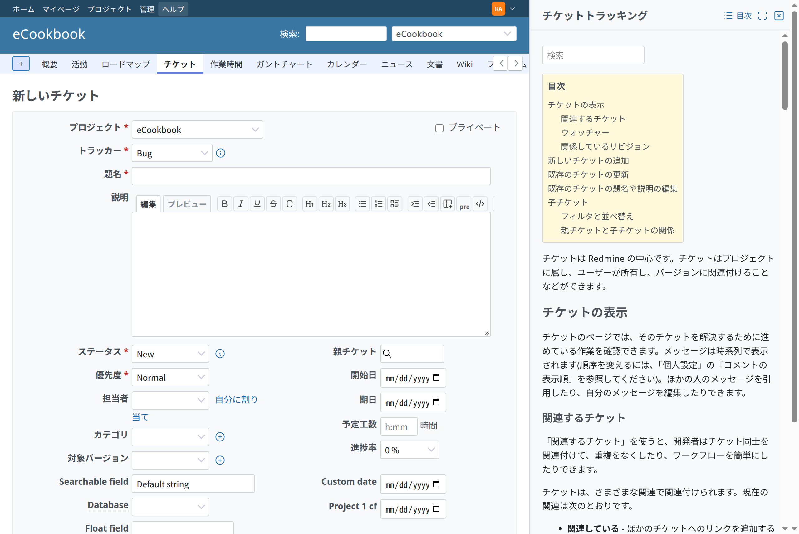
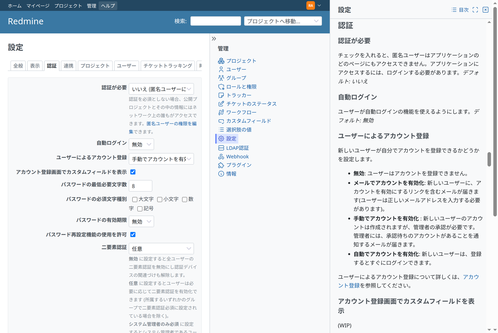

# サイドパネル

ウィンドウの端、画面の横に開くパネルです。画面を操作しながら読む内容 (たとえば画面のヘルプ) に使います。Redmine 7.0.3 にはサイドパネルがないため、このパターンは本体の部品で組み立て、枠だけを小さなスタイルシートで足します。[Redmine Help](https://redmine-kit.github.io/redmine_help/ja/) のパターンです。Redmine Help では、ヘッダーの「ヘルプ」がいま開いている画面のヘルプをサイドパネルに開きます。



<a id="when-to-use-it"></a>

## 使う場面

画面に付随し、画面を操作しながら読む内容に使います。サイドパネルを開いたままでも横の画面を操作でき、フォームにも入力できます。サイドパネルはモーダルではなく、画面を操作できないようにはしません。

終えるか取り消すまで先に進めない作業には、本体のモーダルダイアログ (`showModal`。`div.modal` の jQuery UI のダイアログ。プロジェクトの設定でメンバーを追加するときなど、`members/new.js.erb`) を使います。画面そのものに属する内容には、画面のサイドバー ([画面の組み立て](page.md#sidebar)) を使います。

<a id="markup"></a>

## マークアップ

サイドパネルは `body` の末尾に足す `aside` です。ヘッダーにアクションとタイトルを置き、その下の内容をスクロールします。Redmine Help から (`app/views/redmine_help/panel.html.erb`。スクリプトが `aside` に入れます):

```html
<aside id="help-panel" class="help-panel" role="complementary" aria-labelledby="help-panel-title">
  <div class="help-panel-header">
    <div class="contextual">
      <a class="icon icon-back" role="button" hidden href="#">…</a>
      <a class="icon icon-list" target="_blank" rel="noopener" href="/help">…目次</a>
      <a class="icon-only icon-maximize" title="全画面で表示" target="_blank" rel="noopener" href="/help/user/issues">…</a>
      <a class="icon-only icon-close" title="閉じる" role="button" href="#">…</a>
    </div>
    <h3 id="help-panel-title" tabindex="-1">チケットトラッキング</h3>
  </div>
  <div class="help-panel-content">
    <form id="help-panel-search" action="/help/search" method="get">…</form>
    <div class="wiki wiki-page">…</div>
  </div>
</aside>
```

ヘッダーのアクションは、本体のアクションのリンクです ([アイコンとリンク](icons-and-links.md))。

```erb
<div class="contextual">
  <%= link_to sprite_icon('arrow-narrow-left', l(:button_back), rtl: true), '#', class: 'icon icon-back', role: 'button', hidden: true %>
  <%= link_to sprite_icon('list', l(:label_table_of_contents)), contents_path,
              class: 'icon icon-list', target: '_blank', rel: 'noopener' %>
  <%= link_to sprite_icon('maximize', l(:label_open_in_full_view), icon_only: true), full_view_path,
              class: 'icon-only icon-maximize', title: l(:label_open_in_full_view), target: '_blank', rel: 'noopener' %>
  <%= link_to sprite_icon('close', l(:button_my_plugin_close), icon_only: true), '#',
              class: 'icon-only icon-close', title: l(:button_my_plugin_close), role: 'button' %>
</div>
<h3 id="help-panel-title" tabindex="-1"><%= title %></h3>
```

| 部分 | 本体のもの |
| --- | --- |
| 色と境界線 | サイドバーと同じ。背景 `var(--oc-gray-0)`、開始側に 1px の `var(--oc-gray-4)` の境界線 ([画面の組み立て](page.md#sidebar)) |
| 余白 | サイドバーと同じ `padding-inline: 20px 8px` |
| アクション | ヘッダーの端の `.contextual` に、アクションのリンクを置きます。「戻る」と「目次」はラベル付きの `icon`、ほかはアイコンだけの `icon-only` と `title` です。アイコンはスプライトの `rtl: true` の `arrow-narrow-left`、`list`、`maximize` (本体の PDF の「全画面で表示」と同じ)、`close` です。「目次」は本文の上ではなくヘッダーに置きます。本文の上では、本文自身の目次と紛らわしいためです |
| タイトル | サイドバーのセクションと同じ `h3` |
| 本文 | `div.wiki` (本体の Wiki の書式)。サイドパネルは狭いので、目次は回り込ませません (`{{toc}}`) |
| 検索結果 | 本体の検索と同じ `dl#search-results` |
| 文言 | 本体の `label_open_in_full_view`、`button_back`、`label_table_of_contents`、`label_search`。本体にはパネルを閉じる文言がありません。`button_close` はプロジェクトを終了する操作 (日本語は「終了」) なので、プラグインが自分の文言 (Close、閉じる) を足します |

<a id="css"></a>

## CSS

新しく足すのは枠と位置だけで、サイドパネルの中はすべて本体のものです。色は本体の CSS 変数なので、これらを設定するテーマは、サイドバーと同じくサイドパネルにも反映されます。Redmine Help の `assets/stylesheets/help_panel.css` から:

```css
:root { --help-panel-size: clamp(320px, 33vw, 480px); }

.help-panel {
  position: fixed;
  inset-block: 0;
  inset-inline-end: 0;
  z-index: 100;
  box-sizing: border-box;
  inline-size: var(--help-panel-size);
  display: flex;
  flex-direction: column;
  background: var(--oc-gray-0);
  border-inline-start: 1px solid var(--oc-gray-4);
  font-size: 0.875rem;
}
.help-panel[hidden] { display: none; }
.help-panel [hidden] { display: none; }
.help-panel-header {
  padding-block: 10px 0;
  padding-inline: 20px 8px;
  border-block-end: 1px solid var(--oc-gray-4);
}
.help-panel-content {
  flex: 1;
  overflow: auto;
  overscroll-behavior: contain;
  padding-block: 10px 20px;
  padding-inline: 20px 8px;
}

html.help-panel-open #wrapper { margin-inline-end: var(--help-panel-size); }
html.help-panel-open #sticky-issue-header { inset-inline-end: var(--help-panel-size); }

@media screen and (max-width: 899px) {
  .help-panel { inline-size: auto; inset-inline-start: 0; z-index: 10000; border-inline-start: 0; }
  html.help-panel-open #wrapper { margin-inline-end: 0; }
  html.help-panel-open #sticky-issue-header { inset-inline-end: 0; }
}
```

| ルール | 理由 |
| --- | --- |
| 幅 | ウィンドウの幅ごとの本体のサイドバーの幅 (240px から 380px) と同じくらいです |
| 画面の横の空き | サイドパネルを開いている間、`#wrapper` にマージンを付けます。画面を覆わず、そのまま操作できます。本体のチケットのスティッキーヘッダーはウィンドウに固定されているので、同じだけ空けます |
| `z-index: 100` | jQuery UI の `.ui-front` と同じです。本体のダイアログは後から文書に足されるので、サイドパネルの上に出ます |
| 狭いウィンドウ | 本体のレスポンシブレイアウトのブレークポイント (`responsive.css`、幅 899px まで) では、サイドパネルがウィンドウ全体を覆います。本体の固定ヘッダー (そこでは `z-index: 9999`) より上です |
| サイドパネルの中の `[hidden]` | 本体の `.icon` は `display: inline-flex` なので、`hidden` 属性で隠したアクションのリンク (最初のページの「戻る」) が表示されてしまいます |
| 論理プロパティ | `inset-inline-end`、`border-inline-start`、`margin-inline-end` を使うので、右から左に書く言語ではサイドパネルが左に出ます。本体のルールと同じです |

<a id="behavior"></a>

## 動作

| 項目 | 方法 |
| --- | --- |
| 開閉 | 画面のリンク (Redmine Help ではヘッダーの「ヘルプ」) でサイドパネルを開閉します。サイドパネルの「閉じる」と Esc キーでも閉じます |
| 開閉のリンク | リンクに `role="button"`、`aria-expanded`、`aria-controls` (サイドパネルの id) を付けます。Enter と同じく Space キーでも押せます |
| フォーカス | 開くとタイトル (`tabindex="-1"`) に、閉じると開閉のリンクに戻します。開閉のリンクが閉じたフライアウトメニューの中にある狭いウィンドウでは、メニューのボタンに戻します |
| サイドパネルの中のリンク | サイドパネル自身の内容へのリンクはサイドパネルの中で開き、「戻る」で戻れます。ほかのページへのリンクは新しいウィンドウで開き、横の画面はそのまま残します |
| ページをまたぐ状態 | 開いているかどうかを `localStorage` に保存し (`try`/`catch` で囲みます)、開いていれば次のページでも開きます |
| JavaScript がないとき | 開閉のリンクは、同じ内容の全画面のページへの普通のリンクです |

<a id="compare-with-core"></a>

## 本体と比べる

サイドパネルを開いた画面と開いていない同じ画面のスクリーンショットを、同じ幅で、英語と日本語で撮って比べます。狭くなった幅でも、画面が本体と同じように並ぶことを確認します。狭いウィンドウも確認します。


