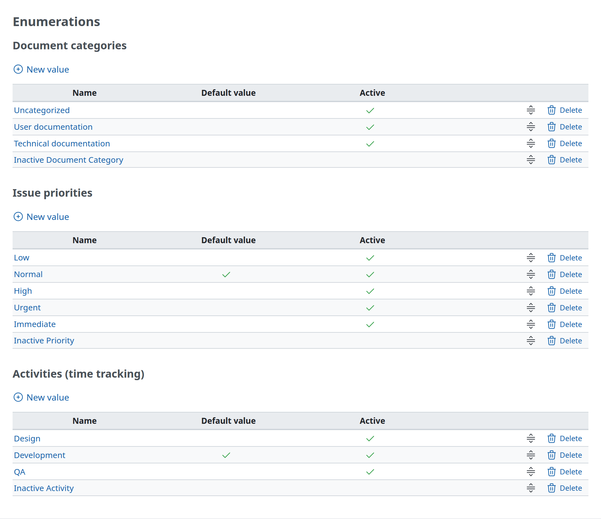

# Lists

A list of records, with an action to add one and actions on each row. The model is Administration › Enumerations (`app/views/enumerations/index.html.erb`).



## Markup

```erb
<h3><%= l(klass::OptionName) %></h3>

<p><%= link_to sprite_icon('add', l(:label_enumeration_new)), new_enumeration_path(:type => klass.name), :class => 'icon icon-add' %></p>

<% if enumerations.any? %>
<table class="list enumerations"><thead>
<tr>
    <th><%= l(:field_name) %></th>
    <th><%= l(:field_is_default) %></th>
    <th><%= l(:field_active) %></th>
    <th></th>
</tr></thead>
<% enumerations.each do |enumeration| %>
<tr>
    <td class="name"><%= link_to enumeration, edit_enumeration_path(enumeration) %></td>
    <td class="tick"><%= checked_image enumeration.is_default? %></td>
    <td class="tick"><%= checked_image enumeration.active? %></td>
    <td class="buttons">
      <%= reorder_handle(enumeration, :url => enumeration_path(enumeration), :param => 'enumeration') %>
      <%= delete_link enumeration_path(enumeration) %>
    </td>
</tr>
<% end %>
</table>
<% else %>
<p class="nodata"><%= l(:label_no_data) %></p>
<% end %>
```

- **The action to add:** an action link in a `<p>` under the heading when the page has several lists. A page with one list puts it in `.contextual` at the top right instead ([Page structure](page.md#title-and-actions)).
- **A class for the kind of list** next to `list` (`enumerations`, `custom_fields`, `users`): it names the table for scripts and themes. Core styles some of them.
- **Empty:** `p.nodata` with `label_no_data` instead of an empty table ([Messages](messages.md#empty-states)).

## Columns

`table.list` centers every cell. The column classes change that:

| Class | Use | Default style |
| --- | --- | --- |
| `name` | The name of the record, usually a link | Start-aligned. Also `description`, `subject`, `comments`, `roles`, `text` |
| `tick` | A yes/no value, with `checked_image` | `inline-size: 15%`, centered |
| `id` | A number that identifies the record | `inline-size: 2%`, centered |
| `buttons` | The actions on the row (`delete_link`, `reorder_handle`, other action links) | End-aligned, `white-space: nowrap`, `0.6em` between links |
| `reorder` | A column of sort handles | `inline-size: 15%`, centered |
| `checkbox` | A checkbox to select the row | `inline-size: 15px` |
| other | Dates, counts, types, states | Centered (the default) |

- `table.list`: `inline-size: 100%`, `font-size: 0.8125rem`, borders above and below, `margin-block-end: 4px`.
- `th`: a gray background (`--oc-gray-2`), `padding: 4px`, `white-space: nowrap`, a 2px border under it.
- `td`: `padding-block: 3px`, `padding-inline-end: 10px`, a border above each row. Even rows get a light background (`tr:nth-child(even)`; white inside a `.box`), and rows highlight on hover.
- `checked_image` shows the check icon for true and nothing for false.
- Leave the `th` of the buttons column empty, as core does.

## Spacing after a list

`table.list` has only `margin-block-end: 4px`. When the next element is a heading, core adds space in one of these ways:

- **Pagination:** `<span class="pagination"><%= pagination_links_full @user_pages, @user_count %></span>` (`app/views/users/index.html.erb`) shows the pages and the number of items per page under the list.
- **A line break:** Administration › Information puts `<br />` after its list, before the next `h3`.
- **The next list's action link:** on Enumerations, the `<p>` of the next section's action link and the heading's own spacing separate the lists.

## Filters

Lists built on queries (issues, users, projects, time entries) start with `fieldset.collapsible` filters (`app/views/queries/_query_form.html.erb`). The legend toggles the fieldset; a saved query starts collapsed:

```erb
<fieldset id="filters" class="collapsible <%= @query.new_record? ? "" : "collapsed" %>">
  <legend onclick="toggleFieldset(this);" class="icon icon-<%= @query.new_record? ? "expanded" : "collapsed" %>">
    <%= sprite_icon(@query.new_record? ? "angle-down" : "angle-right", rtl: !@query.new_record?) %>
    <%= l(:label_filter_plural) %>
  </legend>
  <div style="<%= @query.new_record? ? "" : "display: none;" %>">
    …
  </div>
</fieldset>
```

`fieldset.collapsible` has only a top border (`border-width: 1px 0 0 0`), and its legend has a pointer cursor.
