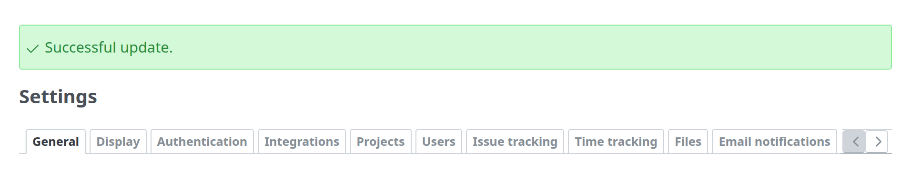
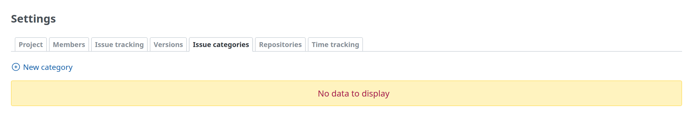

# Messages

Notices after an action, errors, warnings, conflicts and empty states. Redmine draws them all with one style (`#errorExplanation, div.flash, .nodata, .warning, .conflict` in `application.css`): `padding-block: 12px`, `padding-inline: 30px 4px`, `margin-block-end: 12px`, `font-size: 1.1em`, a 1px border and `border-radius: 3px`, with an icon at the start.



## After an action

The controller sets the flash and redirects; the layout renders it at the top of the content (`render_flash_messages`):

```ruby
flash[:notice] = l(:notice_successful_update)
redirect_to settings_path(:tab => params[:tab])
```

```html
<div class="flash notice" id="flash_notice"><svg class="s18 icon-svg" …>…</svg>Successful update.</div>
```

| Flash key | Use | Colors |
| --- | --- | --- |
| `notice` | The action succeeded (`notice_successful_create`, `notice_successful_update`, `notice_successful_delete`, …) | Green |
| `error` | The action failed | Red |
| `warning` | The action succeeded with something to note | Yellow |

- `div.flash` has `margin-block-start: 8px` too.
- Use the core messages (`notice_successful_*`) where they fit, so that the wording matches core in every language.

## Errors in a form

`error_messages_for 'record'` renders `#errorExplanation` (red) with the record's errors, at the top of the form ([Forms](forms.md#errors)). Settings use `render_settings_error` ([Settings](settings.md#errors-and-the-saved-notice)).

## Errors from a service

When a screen shows the result of a call to another service (an API, a connection test), show a failure as a message in these styles, not as an exception's text: a short sentence in the user's language and, where it helps, the error's code or class. For example, an inline warning with the plugin's own message:

```erb
<p class="warning"><%= l(:text_my_plugin_connection_failed) %> (<%= error.code %>)</p>
```

Log the details for the administrator instead of showing them.

## Warnings and conflicts

- `.warning`: yellow and centered (shared with `.nodata`); for example a page that cannot be used as it is.
- `.conflict`: yellow, for a record changed by someone else while it was being edited (`app/views/issues/_conflict.html.erb`).

## Empty states

When a list has nothing to show, `p.nodata` with `label_no_data` takes the place of the table; the action to add stays above it. From `app/views/projects/settings/_issue_categories.html.erb`:

```erb
<p><%= link_to sprite_icon('add', l(:label_issue_category_new)), new_project_issue_category_path(@project), :class => 'icon icon-add' if User.current.allowed_to?(:manage_categories, @project) %></p>

<% if @project.issue_categories.any? %>
<table class="list">
  …
</table>
<% else %>
<p class="nodata"><%= l(:label_no_data) %></p>
<% end %>
```



`.nodata` is centered, yellow (`--oc-yellow-1` background, `--oc-yellow-3` border), like `.warning`.
