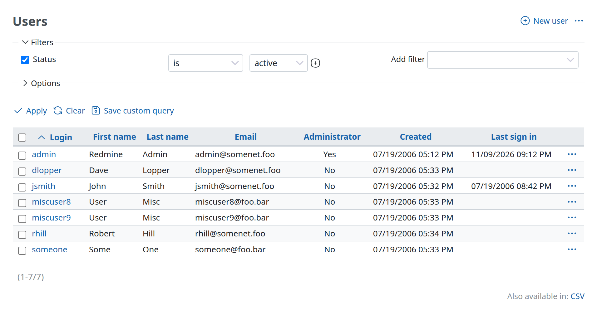
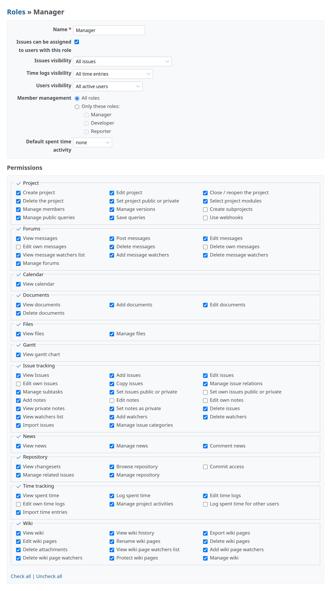
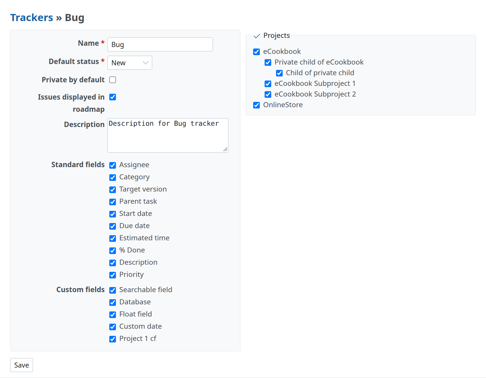
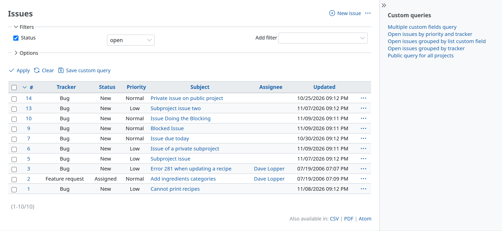

# Page structure

The parts every screen has: the title, the actions at the top right, sections, the sidebar and two columns.



## Title and actions

The actions of the page come first, in `div.contextual`, then the title in `h2`. `title` writes the `h2` (with breadcrumbs when given several parts), and `html_title` sets the browser's title. From `app/views/auth_sources/index.html.erb`:

```erb
<div class="contextual">
<%= link_to sprite_icon('add', l(:label_auth_source_new)), { :action => 'new'}, :class => 'icon icon-add' %>
</div>

<%= title l(:label_auth_source_plural) %>
```

- `.contextual` floats to the end of the line (`float: inline-end`), with `margin-block: 5px`, `padding-inline-start: 10px` and `font-size: 0.9em`. It comes before the `h2` in the markup, so the title flows next to it.
- `h2` is `1.25rem`, `h3` `1.0625rem`. Every heading has `margin-block: 0 10px` (no space above) and `padding-block: 2px 1px`.
- Several actions go in the same `.contextual`, each an action link ([Icons and links](icons-and-links.md)). Rarely used actions go in the `…` menu (`actions_dropdown`), as on the issue page.

## Sections

A section is an `h3` and a `.box` under it. The space between sections comes from the `.box`, not from the heading: `.box` has `margin-block-end: 12px`, and `h3` has no top margin. From `app/views/roles/_form.html.erb`:

```erb
<div class="box tabular">
  <p><%= f.text_field :name, :required => true %></p>
  …
</div>

<h3><%= l(:label_permissions) %></h3>
<div class="box tabular" id="permissions">
  …
</div>
```



- `.box`: `padding: 10px`, `margin-block-end: 12px`, a light background (`--oc-gray-0`), a 1px border (`--oc-gray-2`), `border-radius: 3px`, `line-height: 1.5em`.
- A table that ends a section without a box (`table.list` has only `margin-block-end: 4px`) leaves little space before the next `h3`. Core puts a `<br />` after it (Administration › Information), or follows it with the next block that has its own margin (pagination, a `.box`). See [Lists](lists.md#spacing-after-a-list).

## Two columns

`.splitcontent` with `.splitcontentleft` and `.splitcontentright` puts two blocks side by side; they wrap under each other on narrow screens. From `app/views/trackers/_form.html.erb`:

```erb
<div class="splitcontent">
<div class="splitcontentleft">
<div class="box tabular">
  …
</div>
</div>

<div class="splitcontentright">
<fieldset class="box" id="tracker_project_ids"><legend><%= toggle_checkboxes_link("#tracker_project_ids input[type=checkbox]") %><%= l(:label_project_plural) %></legend>
  …
</fieldset>
</div>
</div>
```



- `.splitcontent` is a wrapping flex box; each column is `flex: 1`, with `5px` between them.

## Sidebar

A page fills the sidebar with `content_for :sidebar`. The sidebar uses `h3` for its sections and plain lists of links.



- `#sidebar`: `font-size: 0.8125rem`, `padding-inline: 20px 8px`, a light background and a border on its start side.
- `#sidebar h3`: `0.875rem`, `margin-block-start: 14px` (none for the first).
- `#sidebar ul` has no margin or padding; the current item is `a.selected`.

The sidebar is shown only when a page sets it, and the user can hide it (`#sidebar-switch-button`).
