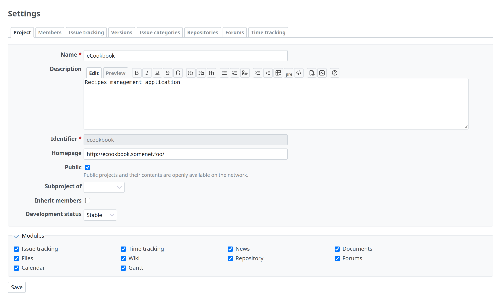

# Project settings

A project's settings are tabs on Project › Settings (`app/views/projects/settings.html.erb`), each tab a partial under `app/views/projects/settings/`.



## The tabs

```erb
<h2><%=l(:label_settings)%></h2>

<%= render_tabs project_settings_tabs %>
```

`project_settings_tabs` (`app/helpers/projects_helper.rb`) lists the tabs and keeps those the user may use:

```ruby
{:name => 'issues', :action => :edit_project, :module => :issue_tracking,
 :partial => 'projects/settings/issues', :label => :label_issue_tracking},
…
tabs.
  select {|tab| User.current.allowed_to?(tab[:action], @project)}.
  select {|tab| tab[:module].nil? || @project.module_enabled?(tab[:module])}
```

- `:action` is the permission that shows the tab, `:module` the project module it needs.
- Redmine has no hook for project settings tabs. A plugin adds one by prepending a module to `ProjectsHelper` that calls `super` and appends its tab, with its own permission:

```ruby
module MyPlugin
  module ProjectSettingsTab
    def project_settings_tabs
      tabs = super
      if User.current.allowed_to?(:manage_my_plugin, @project)
        tabs << {name: 'my_plugin', action: :manage_my_plugin,
                 partial: 'my_plugin/project_settings', label: :label_my_plugin}
      end
      tabs
    end
  end
end

ProjectsHelper.prepend(MyPlugin::ProjectSettingsTab)
```

## A tab's content

A tab is a form like the others ([Forms](forms.md)): `labelled_form_for` the project (or the plugin's record), a hidden `tab` field so that saving comes back to the same tab, the fields in `.box.tabular`, and the save button. From `app/views/projects/settings/_issues.html.erb`:

```erb
<%= labelled_form_for @project, html: {id: 'project_issue_tracking' } do |f| %>
  <%= hidden_field_tag 'tab', 'issues' %>

  <fieldset class="box tabular" id="project_trackers"><legend><%= toggle_checkboxes_link('#project_trackers input[type=checkbox]') %><%= l(:label_tracker_plural)%></legend>
  <% if User.current.admin? %>
    <div class="contextual"><%= link_to sprite_icon('settings', l(:label_administration)), trackers_path, :class => "icon icon-settings" %></div>
  <% end %>
  <% @trackers.each do |tracker| %>
    <label class="floating">
      <%= check_box_tag 'project[tracker_ids][]', tracker.id, @project.trackers.to_a.include?(tracker), :id => nil %>
      <%= tracker_name_tag tracker %>
    </label>
  <% end %>
  </fieldset>
  …
<% end %>
```

- **Many checkboxes in a box:** `label.floating` (normal weight, start-aligned, 270px wide) puts them in columns.
- **A link to the matching administration page** for administrators: `.contextual` inside the fieldset, with `icon icon-settings`.
- **A list with actions** (versions, categories, repositories) follows [Lists](lists.md), with the add action as a `<p>` link above it.
