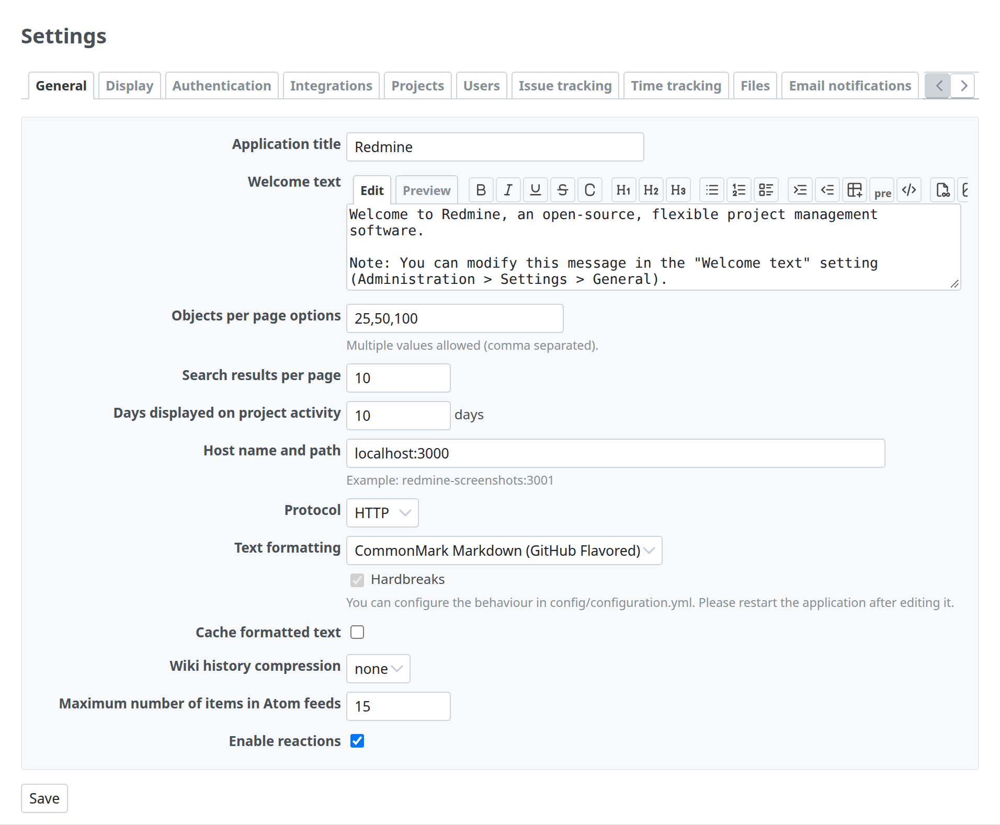
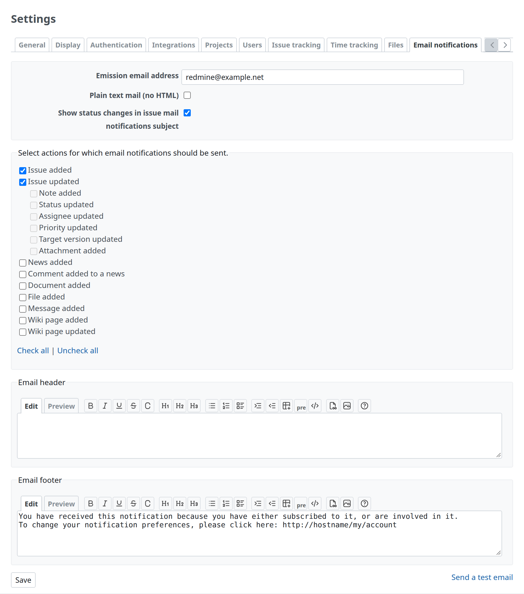

# Settings

Settings in tabs, each tab a form of labelled fields. The model is Administration › Settings (`app/views/settings/edit.html.erb` and the partials `app/views/settings/_*.html.erb`).



## Tabs

`render_tabs` draws the tabs and the content of each tab from a list of hashes; the selected tab comes from the `tab` parameter. From `app/views/settings/edit.html.erb`:

```erb
<h2><%= l(:label_settings) %></h2>

<%= render_settings_error @setting_errors %>

<%= render_tabs administration_settings_tabs %>
```

```ruby
tabs = [
  {:name => 'general', :partial => 'settings/general', :label => :label_general},
  {:name => 'display', :partial => 'settings/display', :label => :label_display},
  …
]
```

- `#content .tabs`: `block-size: 2.6em`, `margin-block-end: 1.2em`; the selected tab is `a.selected`. When the tabs do not fit, scroll buttons appear (`div.tabs-buttons`).
- Each tab's content is a `div.tab-content` with the id `tab-content-<name>`; the others are hidden.

## Fields

Each tab is one form. The fields are in `div.box.tabular.settings`, one `<p>` per setting, with the `setting_*` helpers. The save button comes after the box. From `app/views/settings/_general.html.erb`:

```erb
<%= form_tag({:action => 'edit'}) do %>

<div class="box tabular settings">
<p><%= setting_text_field :app_title, :size => 30 %></p>

<p><%= setting_text_field :per_page_options, :size => 20 %>
<em class="info"><%= l(:text_comma_separated) %></em></p>

<p><%= setting_text_field :activity_days_default, :size => 6 %> <%= l(:label_day_plural) %></p>

<p><%= setting_select :protocol, [['HTTP', 'http'], ['HTTPS', 'https']] %></p>
</div>

<%= submit_tag l(:button_save) %>
<% end %>
```

- `setting_text_field`, `setting_textarea`, `setting_select`, `setting_multiselect` and `setting_check_box` write the label (`setting_<name>` in the locale, or `:label`) and the field. `setting_check_box` adds a hidden `0` so that an unchecked box is saved.
| Item | Details |
| --- | --- |
| Labels | `.tabular label` is bold, end-aligned and floats into the left column. In `.tabular.settings` the left column is 300px (`p` has `padding-inline-start: 300px`, `font-size: 93%`; `label` is 295px wide with `margin-inline-start: -300px`), wider than in other forms (180px). Keep labels short enough for one line; longer explanations go in `em.info` |
| Help under a field | `em.info` after the field, inside the same `<p>` (`display: block`, `font-size: 90%`, gray) |
| A unit after a field | Plain text after the field (`… %> <%= l(:label_day_plural) %>`) |
- **Several boxes** split a long tab into groups; the space between them comes from `.box`'s `margin-block-end: 12px`.

## Checkboxes with their text after them

An option of a field, with its text after the checkbox: `label.block` around the checkbox, inside the field's `<p>`, and `:label => false` so that the helper writes no left label. From `app/views/settings/_mail_handler.html.erb`:

```erb
<p>
  <%= setting_textarea :mail_handler_body_delimiters, :rows => 5 %>
  <label class="block">
    <%= setting_check_box :mail_handler_enable_regex_delimiters, :label => false %>
    <%= l(:setting_mail_handler_enable_regex) %>
  </label>
  <em class="info"><%= l(:text_line_separated) %></em>
</p>
```

- `.tabular label.block`: normal weight, start-aligned, not floating, full width (`display: block`).

A group of related choices, each a checkbox with its text after it, is a `fieldset.box` with a `legend`, one `label` per choice, and check all / uncheck all links. From `app/views/settings/_notifications.html.erb`:

```erb
<fieldset class="box" id="notified_events"><legend><%=l(:text_select_mail_notifications)%></legend>
<%= hidden_field_tag 'settings[notified_events][]', '' %>
<% @notifiables.each do |notifiable| %>
<%= notification_field notifiable %>
<br />
<% end %>
<p><%= check_all_links('notified_events') %></p>
</fieldset>
```



- `notification_field` writes `<label><input type="checkbox" …> text</label>`; a child option gets `class="parent"` and is indented (`fieldset#notified_events .parent`: `padding-inline-start: 20px`).
- `check_all_links` writes "Check all | Uncheck all".

## A related action

An action next to the settings, such as sending a test email, is a plain link floated to the end, on the row of the save button. From the same partial:

```erb
<div style="float:right;">
<%= link_to l(:label_send_test_email), test_email_path, :method => :post %>
</div>

<%= submit_tag l(:button_save) %>
```

## Errors and the saved notice

- `render_settings_error @setting_errors` lists the settings that could not be saved, with their labels, in `#errorExplanation` above the tabs.
- After saving, the controller sets `flash[:notice] = l(:notice_successful_update)` and redirects to the same tab; the layout shows it above the title ([Messages](messages.md)).

## A plugin's settings

A plugin that declares `settings :partial => 'settings/…'` gets Administration › Plugins › Configure. Redmine wraps the partial in the same `.box.tabular.settings` (`app/views/settings/plugin.html.erb`), so the partial holds only the `<p>` rows:

```erb
<div id="settings" class="plugin plugin-<%= @plugin.id %>">
<%= form_tag({:action => 'plugin'}) do %>
<div class="box tabular settings">
<%= render :partial => @partial, :locals => {:settings => @settings}%>
</div>
<%= submit_tag l(:button_apply) %>
<% end %>
</div>
```
