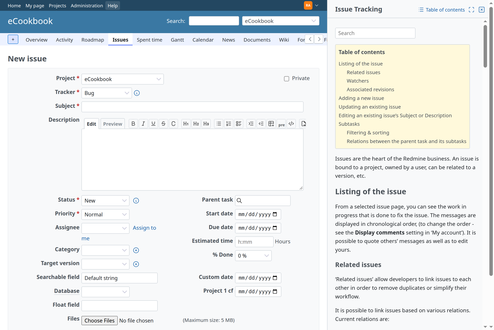
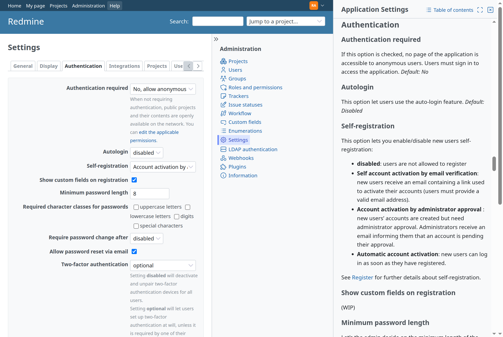

# Side panel

A panel at the end side of the window, next to the page, for content that is read while working on the page: help for the screen, for example. Redmine 7.0.3 has no side panel, so this pattern is built from core's pieces with a small stylesheet for the frame. It comes from [Redmine Help](https://redmine-kit.github.io/redmine_help/), whose header link opens the help for the current screen in a side panel.



## When to use it

Use a side panel for content that goes with the page and is read while the page is used: the page stays usable next to it, and a form can be filled in while the panel is open. The panel is not modal; it does not block the page.

For a task that has to be finished or cancelled before going on, use core's modal dialog instead (`showModal`, a jQuery UI dialog with `div.modal`, as for a new member in a project's settings, `members/new.js.erb`). For content that belongs to the page itself, use the page's own sidebar ([Page structure](page.md#sidebar)).

## Markup

The panel is an `aside`, appended to `body`. A header holds the actions and the title; the content below it scrolls. From Redmine Help (`app/views/redmine_help/panel.html.erb`, put into the `aside` by its script):

```html
<aside id="help-panel" class="help-panel" role="complementary" aria-labelledby="help-panel-title">
  <div class="help-panel-header">
    <div class="contextual">
      <a class="icon icon-back" role="button" hidden href="#">…</a>
      <a class="icon icon-list" target="_blank" rel="noopener" href="/help">…Table of contents</a>
      <a class="icon-only icon-maximize" title="Open in full view" target="_blank" rel="noopener" href="/help/user/issues">…</a>
      <a class="icon-only icon-close" title="Close" role="button" href="#">…</a>
    </div>
    <h3 id="help-panel-title" tabindex="-1">Issue tracking</h3>
  </div>
  <div class="help-panel-content">
    <form id="help-panel-search" action="/help/search" method="get">…</form>
    <div class="wiki wiki-page">…</div>
  </div>
</aside>
```

The header's actions are core's action links ([Icons and links](icons-and-links.md)):

```erb
<div class="contextual">
  <%= link_to sprite_icon('arrow-narrow-left', l(:button_back), rtl: true), '#', class: 'icon icon-back', role: 'button', hidden: true %>
  <%= link_to sprite_icon('list', l(:label_table_of_contents)), contents_path,
              class: 'icon icon-list', target: '_blank', rel: 'noopener' %>
  <%= link_to sprite_icon('maximize', l(:label_open_in_full_view), icon_only: true), full_view_path,
              class: 'icon-only icon-maximize', title: l(:label_open_in_full_view), target: '_blank', rel: 'noopener' %>
  <%= link_to sprite_icon('close', l(:button_my_plugin_close), icon_only: true), '#',
              class: 'icon-only icon-close', title: l(:button_my_plugin_close), role: 'button' %>
</div>
<h3 id="help-panel-title" tabindex="-1"><%= title %></h3>
```

| Part | From core |
| --- | --- |
| Colors and border | The sidebar's: `var(--oc-gray-0)` background, a 1px `var(--oc-gray-4)` border on the start side ([Page structure](page.md#sidebar)) |
| Padding | The sidebar's: `padding-inline: 20px 8px` |
| Actions | `.contextual` at the end of the header, with action links: `icon` with a label for Back and Table of contents, `icon-only` and a `title` for the others. Icons from the sprite: `arrow-narrow-left` with `rtl: true`, `list`, `maximize` (as core's "Open in full view" of a PDF), `close`. Table of contents sits in the header rather than above the text, where it would read as the text's own table of contents |
| Title | `h3`, as the sidebar's sections |
| Text | `div.wiki` (and core's wiki formatting); a table of contents that does not float (`{{toc}}`), since the panel is narrow |
| Search results | `dl#search-results`, as core's search |
| Strings | Core's: `label_open_in_full_view`, `button_back`, `label_table_of_contents`, `label_search`. Core has no string for closing a panel: `button_close` is the action that closes a project (終了 in Japanese), so the plugin adds its own (Close, 閉じる) |

## CSS

Only the frame and the position are new; everything inside the panel is core's. The colors are core's variables, so a theme that sets them styles the panel as it styles the sidebar. From Redmine Help's `assets/stylesheets/help_panel.css`:

```css
:root { --help-panel-size: clamp(320px, 33vw, 480px); }

.help-panel {
  position: fixed;
  inset-block: 0;
  inset-inline-end: 0;
  z-index: 100;
  box-sizing: border-box;
  inline-size: var(--help-panel-size);
  display: flex;
  flex-direction: column;
  background: var(--oc-gray-0);
  border-inline-start: 1px solid var(--oc-gray-4);
  font-size: 0.875rem;
}
.help-panel[hidden] { display: none; }
.help-panel [hidden] { display: none; }
.help-panel-header {
  padding-block: 10px 0;
  padding-inline: 20px 8px;
  border-block-end: 1px solid var(--oc-gray-4);
}
.help-panel-content {
  flex: 1;
  overflow: auto;
  overscroll-behavior: contain;
  padding-block: 10px 20px;
  padding-inline: 20px 8px;
}

html.help-panel-open #wrapper { margin-inline-end: var(--help-panel-size); }
html.help-panel-open #sticky-issue-header { inset-inline-end: var(--help-panel-size); }

@media screen and (max-width: 899px) {
  .help-panel { inline-size: auto; inset-inline-start: 0; z-index: 10000; border-inline-start: 0; }
  html.help-panel-open #wrapper { margin-inline-end: 0; }
  html.help-panel-open #sticky-issue-header { inset-inline-end: 0; }
}
```

| Rule | Why |
| --- | --- |
| Width | About the width of core's sidebar at each window width (core's sidebar is 240px to 380px) |
| Room next to the page | A margin on `#wrapper` while the panel is open, so that the page is not covered and stays usable. Core's sticky issue header is fixed to the window, so it gets the same room |
| `z-index: 100` | jQuery UI's `.ui-front`: core's dialogs open later in the document and come above the panel |
| Narrow windows | At core's responsive breakpoint (`responsive.css`, up to 899px), the panel covers the window, above core's fixed header (`z-index: 9999` there) |
| `[hidden]` inside the panel | Core's `.icon` is `display: inline-flex`, which would show an action link hidden with the `hidden` attribute (Back on the first page) |
| Logical properties | `inset-inline-end`, `border-inline-start` and `margin-inline-end` put the panel at the left in right-to-left languages, as core's own rules do |

## Behavior

| Item | How |
| --- | --- |
| Opening and closing | A link in the page (Redmine Help: the header's Help link) toggles the panel. Close in the panel and Esc close it too |
| The toggle | The link gets `role="button"`, `aria-expanded` and `aria-controls` (the panel's id); Space presses it as Enter does |
| Focus | Opening moves the focus to the title (`tabindex="-1"`); closing moves it back to the toggle. On narrow windows, where the toggle is in the closed flyout menu, to the menu's button |
| Links in the panel | Links of the panel's own content load in the panel, with Back; links to other pages open in a new window, so that the page next to the panel stays |
| Kept across pages | Whether the panel is open is kept in `localStorage` (in `try`/`catch`), and an open panel opens again on the next page |
| Without JavaScript | The toggle is a plain link to a full page with the same content |

## Compare with core

Take screenshots of the page with the panel open and of the same page without it, at the same width, in English and Japanese, and check that the page still lays out as core does in the narrower width. Check a narrow window too.


